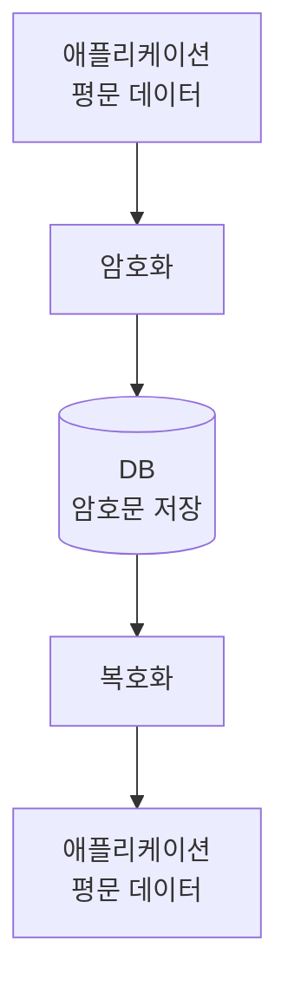
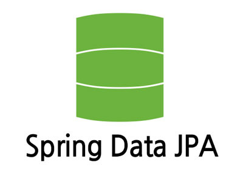

개인정보와 같은 민감한 데이터를 DB에 저장할 때는 데이터의 특성과 보안 요구사항에 따라 적절한 암호화 조치를 적용해야 합니다.

제가 근무하는 회사에서는 민감한 데이터를 보호하기 위해 오래전부터 상용 DB 암호화 솔루션을 사용하고 있습니다. 검증된 솔루션을 활용하면 암호화 기능을 직접 개발하고 운영하는 부담을 줄일 수 있다는 장점이 있습니다. 하지만 암호화 적용 범위가 확대될수록 라이선스 비용과 운영 부담도 함께 증가합니다.

물론, 직접 암호화 기능을 구현한다고 해서 반드시 비용이 절감되거나 보안성이 높아지는 것은 아닙니다. 암호키 관리, 성능, 장애 대응까지 애플리케이션이 책임져야 하는 범위가 확대되기 때문입니다.

그럼에도 민감한 데이터가 저장되는 특정 컬럼에 대한 암호화를 애플리케이션에서 일관되게 처리할 수 있다면 일부 환경에서는 유연한 대안이 될 수 있을 것 같았습니다. 그래서 직접 구현해보기로 했습니다.

---

## 1. 애플리케이션 레벨 암호화란?

애플리케이션 레벨 암호화(Application-Level Encryption)는 DB에 데이터를 저장하기 전에 애플리케이션에서 암호화하고, 조회한 데이터를 애플리케이션에서 복호화하는 방식입니다.

중요한 특징은 암·복호화 시점과 처리 방식을 애플리케이션에서 직접 통제할 수 있다는 것입니다.

다만 DB에 암호문이 저장된다고 해서 데이터가 완전히 보호되는 것은 아닙니다. 암호화 키의 보관과 접근 통제, 복호화 권한, 로그를 통한 평문 노출 방지 등 다양한 보안 요소도 함께 고려해야 합니다.

---

## 2. DB 레벨 암호화와 애플리케이션 레벨 암호화의 차이

DB에 저장된 데이터를 보호하는 방법은 다양합니다.

대표적으로 DB 자체 또는 연동 솔루션을 통해 암호화를 수행하는 방식(**DB 레벨 암호화**)과 애플리케이션이 직접 암호화를 수행하는 방식(**애플리케이션 레벨 암호화**)이 있습니다.

DB 레벨 암호화는 구현 방식에 따라 보호 범위와 동작 방식이 달라질 수 있습니다. 여기에서는 DB 또는 연동 솔루션에서 암·복호화를 수행하는 방식을 기준으로 애플리케이션 레벨 암호화와 차이점을 비교하겠습니다.

| 구분 | DB 레벨 암호화 | 애플리케이션 레벨 암호화 |
|---|---|---|
| 암·복호화 위치 | DB 또는 연동 솔루션 | 애플리케이션 |
| 애플리케이션 수정 | 방식에 따라 불필요하거나 제한적 | 암호화 처리 로직 필요 |
| 암호화 범위 제어 | 솔루션 기능에 따라 다름 | 애플리케이션에서 세밀하게 제어 |
| 키 관리 | DB 또는 솔루션의 관리 체계 | 별도 관리 체계 필요 |
| 운영 책임 | DB 및 솔루션 운영 영역 | 애플리케이션 운영 영역 |
| 검색 및 쿼리 | 암호화 방식에 따라 제약 발생 | 암호문 검색 등에 별도 설계 필요 |

어느 방식이 더 안전하거나 우수하다고 단정하기는 어렵습니다. 암호화 방식의 선택은 보호해야 하는 데이터와 예상되는 보안 위협, 운영 환경에 따라 달라지기 때문입니다.

결국 중요한 것은 **어느 계층에서 암호화를 수행할 것인지보다 무엇을 보호하려는지 명확하게 정의하는 것**이라고 생각합니다.

---

## 3. 애플리케이션 레벨 암호화의 장점

애플리케이션 레벨 암호화는 개발자가 직접 관여해야 할 부분이 많지만 다음과 같은 장점이 있습니다.

### 3.1. 암호화 대상의 세밀한 제어가 가능

애플리케이션은 데이터의 특성과 비즈니스 요구사항을 알고 있습니다.

따라서 컬럼별 암호화 필요 여부뿐만 아니라, 데이터의 사용 목적과 처리 흐름을 고려하여 암·복호화 정책을 적용할 수 있습니다.

### 3.2. DB 접근만으로 평문을 확인하기 어려움

애플리케이션에서 암호화한 데이터를 DB에 저장하고 암호화 키를 별도로 관리한다면 DB에 직접 접근하더라도 평문을 확인하기 어려울 수 있습니다.

이는 DB 접근 권한이나 DB 백업 파일이 유출되는 상황에서 추가적인 보호 수단이 될 수 있습니다. 

다만 애플리케이션 자체가 침해되거나 암호화 키가 함께 유출된다면 데이터를 복호화할 가능성이 있으므로 별도의 보안 대책이 필요합니다.

### 3.3. 특정 상용 솔루션에 대한 의존도 감소

애플리케이션에서 표준 암호화 기술과 라이브러리를 활용한다면 특정 DB 암호화 솔루션에 대한 의존도를 줄일 수 있습니다.

DBMS를 변경하는 상황에서도 암호화 기능을 애플리케이션의 공통 기능으로 유지할 수 있다는 장점이 있습니다.

물론 직접 개발한 기능의 유지보수와 보안 검증 비용까지 고려해야 하므로 반드시 경제적으로 유리한 것은 아닙니다.

---

## 4. 애플리케이션 레벨 암호화의 한계

반대로 애플리케이션이 암·복호화를 책임지면 새로운 문제도 발생합니다.

### 4.1. 암호화 로직이 여러 곳에 분산될 가능성 존재

개발자가 데이터를 저장하거나 조회할 때마다 암·복호화 코드를 작성한다면 중복 구현이 발생할 수 있습니다.

또한 일부 처리 경로에서 암호화를 누락하거나 서로 다른 방식으로 구현하는 문제도 생길 수 있습니다.

따라서 애플리케이션 레벨 암호화를 도입한다면 **암·복호화 기능을 공통화하고 일관된 규칙으로 적용하는 구조**가 필요합니다.

### 4.2. 데이터 검색에 제약이 발생

암호화된 데이터는 일반적인 평문 데이터처럼 검색하거나 비교하기 어렵습니다.

예를 들어 AES-GCM에서 매번 새로운 nonce(IV)를 사용하면 동일한 데이터를 암호화하더라도 서로 다른 암호문이 생성됩니다. 따라서 암호문 자체를 이용한 일반적인 동등 비교가 어려워질 수 있습니다.

이러한 특성으로 인해 다음과 같은 기능은 별도 설계가 필요할 수 있습니다.

- 암호화된 컬럼에 대한 정확한 값 검색
- 중복 데이터 확인
- 정렬 및 범위 검색
- 통계 및 집계 처리

특히 검색을 위해 암호화 방식을 부적절하게 변경하면 데이터의 보안성이 낮아질 수 있으므로 주의해야 합니다.

### 4.3. 암호화 키 관리와 운영 책임이 발생

암호화 기능을 구현하는 것만큼 중요한 것이 암호화 키의 관리입니다.

그렇다고 애플리케이션에서 암호화 키까지 직접 저장하고 관리할 필요는 없습니다.

별도의 키 관리 시스템을 활용할 수도 있지만, 애플리케이션은 키에 대한 접근 권한과 사용 방식, 키 교체 및 장애 상황을 고려해야 합니다.

**특히 암호화 키가 유실되면 저장된 데이터를 복호화하지 못할 수 있으므로, 키의 안전한 보관과 복구 방안까지 함께 준비해야 합니다.**

---

## 5. 애플리케이션 레벨 암호화 적용 시 고려할 점

애플리케이션 레벨 암호화를 적용해보려면 우선 다음과 같은 질문을 해볼 필요가 있습니다.

**첫째, 어떤 위협으로부터 데이터를 보호해야 하는가?**

DB 백업 파일 유출을 방지하려는 것인지 DB에 직접 접근할 수 있는 사용자로부터 평문을 보호하려는 것인지에 따라 적합한 암호화 방식이 달라집니다.

**둘째, 암호화된 데이터에 어떤 기능이 필요한가?**

저장과 단순 조회가 대부분인 데이터인지 검색이나 정렬, 통계 처리가 빈번한 데이터인지 확인해야 합니다.

**셋째, 암호화 키를 안전하게 관리할 수 있는가?**

애플리케이션에서 직접 암호화를 수행하더라도 키를 안전하게 관리할 수 없다면 충분한 보안성을 확보하기 어렵습니다.

**넷째, 암호화 기능을 일관되게 적용할 수 있는가?**

여러 개발자가 각자의 방식으로 암호화 기능을 구현한다면 관리가 복잡해지고 보안 취약점이 발생할 가능성이 높아집니다.

이러한 조건을 종합적으로 검토한 후 애플리케이션 레벨 암호화의 적용 여부를 결정하는 것이 바람직합니다.

---

## 6. JPA DB 컬럼 암호화 프로젝트의 목표

이번 프로젝트는 **비즈니스 로직과 암호화 처리 로직을 분리하고, 일관된 방식으로 DB 컬럼 암호화를 적용할 수 있는 구조**를 직접 만들어보고 싶어서 시작했습니다.

이를 통해 애플리케이션 레벨에서 DB 컬럼 암호화를 구현할 때 어떤 구조가 적절하고, 실제 구현 과정에서 어떤 문제를 고려해야 하는지 확인해보고자 합니다.

특히 개별 비즈니스 로직에서 암·복호화 코드를 반복해서 작성하는 방식은 피하고 싶었습니다.

그래서 비즈니스 로직에서 직접 암·복호화를 호출하지 않고도 특정 컬럼에 암호화 처리를 적용할 수 있는 방법을 검토했습니다.

`JPA`에서는 `Entity`의 속성과 DB 컬럼 사이에서 데이터를 변환할 수 있는 확장 기능을 제공합니다. 이러한 기능을 활용하면 목표로 하는 구조를 구현할 수 있을 것으로 판단했습니다.

---

## 7. 다음 포스팅

다음 포스팅에서는 이러한 목표를 구현하기 위해 `JPA`에서 제공하는 `AttributeConverter`를 선택한 이유와 다른 구현 방법에 비해 어떤 장점과 제약이 있는지 살펴보겠습니다.
