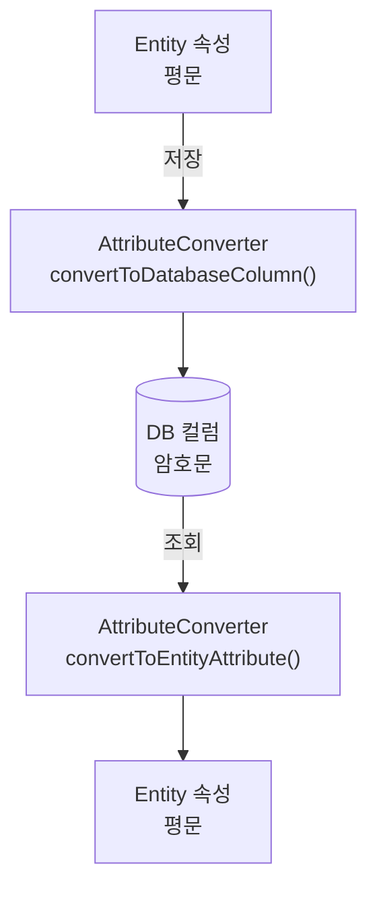

비즈니스 로직과 암호화 처리 로직을 분리하고, 일관된 방식으로 DB 컬럼 암호화를 적용하기 위해서는 암·복호화 로직을 어디에 두고 어떤 시점에 실행할 것인지 결정해야 합니다.

---

## 1. 서비스 계층에서 암·복호화를 수행하는 방식

가장 먼저 떠오른 방법은 서비스 계층에서 직접 암·복호화를 수행하는 것이었습니다.

서비스 계층에서 데이터를 저장하기 전에 암호화하고, 조회한 이후에 복호화하는 방법은 직관적이고 구현하기도 어렵지 않습니다.

하지만 애플리케이션의 규모가 커지고 암호화 대상이 늘어나면 몇 가지 문제가 발생할 수 있습니다.

| 문제점 | 내용 |
|---|---|
| 비즈니스 로직과 암호화 로직의 혼재 | 서비스 계층에서 비즈니스 규칙뿐 아니라 암·복호화 처리까지 담당하게 되어 책임이 복잡해질 수 있습니다. |
| 암호화 적용 누락 위험 | 개발자가 암호화 대상 필드를 확인하고 처리 코드를 작성해야 하므로 일부 경로에서 암호화가 누락될 수 있습니다. |
| 공통 규칙 유지의 어려움 | 여러 서비스에 암·복호화 코드가 분산되면 암호화 정책 변경 시 수정 범위가 확대될 수 있습니다. |

물론 암호화 기능을 별도의 서비스나 공통 라이브러리로 분리하면 일부 문제를 개선할 수 있습니다.

그렇지만 서비스 계층에서 암·복호화를 직접 호출하는 구조라면 저장하거나 조회하는 코드마다 해당 기능을 호출해야 한다는 점은 달라지지 않습니다.

암호화 대상이 늘어나더라도 개발자가 매번 암·복호화 처리를 신경 쓸 필요가 없도록 만들고 싶었기 때문에 이 방식은 배제하게 되었습니다.

---

## 2. Entity 내부에서 암·복호화를 수행하는 방식

다음으로 검토한 방식은 `Entity` 내부에서 암·복호화를 수행하는 것이었습니다.

하지만 `Entity` 내부에 직접 암·복호화 로직을 작성하는 방식은 다음과 같은 한계가 있습니다.

| 문제점 | 내용 |
|---|---|
| `Entity`의 책임 증가 | 도메인 데이터와 관련된 역할 외에 암호화 정책과 구현 세부사항까지 함께 관리하게 됩니다. |
| 암호화 로직의 분산 | 여러 Entity에 유사한 암·복호화 코드가 반복될 수 있습니다. |
| 암호화 정책 변경의 부담 | 암호화 알고리즘이나 키 관리 방식이 변경되면 여러 Entity를 수정해야 할 수 있습니다. |
| 도메인 모델의 복잡도 증가 | Entity가 데이터의 상태뿐 아니라 암호화 처리 과정까지 관리하면서 코드의 가독성이 낮아질 수 있습니다. |

`Entity Listener`를 활용한다면 암호화 로직을 `Entity` 외부로 분리할 수 있으므로 이러한 문제를 일부 개선할 수 있습니다.

다만 `Entity Listener`에서 암호화된 값을 `Entity`에 직접 반영하는 방식이라면 애플리케이션에서 평문과 암호문 상태를 어떻게 구분하고 관리할 것인지도 고려해야 합니다.

물론 별도의 필드를 두거나 변환 상태를 관리하는 방식으로 해결할 수도 있습니다. 하지만 이러한 부가적인 상태 관리 없이 컬럼 값 자체를 변환하는 구조를 구현하고 싶었기 때문에, 이 방식도 배제하게 되었습니다.

---

## 3. AttributeConverter를 선택한 이유

서비스 계층과 `Entity` 내부에서 암·복호화를 수행하는 방식을 검토하면서 한 가지 생각이 들었습니다.

**암·복호화 기능을 어디에 구현할 것인가보다, 어느 시점에 자동으로 실행하도록 할 것인가가 더 중요한 문제 아닐까?**

애플리케이션 레벨 암호화에서는 데이터를 DB에 저장하기 전에 암호화하고, DB에서 조회한 후에는 복호화해야 합니다.

그렇다면 `Entity`의 속성과 DB 컬럼 사이에서 값이 변환되는 시점에 암·복호화 처리를 적용하는 것이 자연스럽다고 생각했습니다.

`JPA`에서 제공하는 `AttributeConverter`는 이러한 목적에 적합한 확장 기능입니다.

### 3.1. AttributeConverter란?

`AttributeConverter`는 Entity의 속성과 DB 컬럼에 저장되는 값 사이의 변환을 처리하기 위해 `JPA`에서 제공하는 인터페이스입니다.

다음 두 가지 메서드를 제공합니다.

| 메서드 | 역할 |
|---|---|
| `convertToDatabaseColumn()` | Entity 속성의 값을 DB에 저장할 형태로 변환 |
| `convertToEntityAttribute()` | DB에서 조회한 값을 Entity 속성의 값으로 변환 |

`AttributeConverter`는 `Entity` 속성의 값을 DB 컬럼에 저장할 수 있는 형태로 변환하기 위한 범용 기능입니다. 이러한 변환 과정에 암·복호화 처리를 적용하면 DB 컬럼 암호화에도 활용할 수 있습니다. 

위와 같이 동작한다면 애플리케이션의 비즈니스 로직이 암·복호화 처리에 직접 관여하지 않아도 됩니다.

### 3.2. 비즈니스 로직과 암호화 로직의 분리

`AttributeConverter`를 활용하면 암·복호화 기능을 별도의 Converter에 구현하고, 암호화가 필요한 `Entity` 속성에 적용할 수 있습니다.

이를 통해 비즈니스 로직은 평문 데이터를 다루고, Converter는 DB에 저장하거나 조회하는 과정에서 필요한 데이터 변환을 담당하도록 역할을 분리할 수 있습니다.

또한 공통 암호화 기능을 재사용할 수 있도록 설계하면 여러 `Entity`에 일관된 암호화 정책을 적용하는 것도 가능합니다.

비즈니스 로직에서 암·복호화 기능을 직접 호출하지 않고도 데이터 변환 과정에 암·복호화 처리를 적용할 수 있다는 점에서 `AttributeConverter`가 이번 프로젝트의 목표에 적합하다고 판단했습니다.

---

## 4. AttributeConverter를 활용할 때 고려해야 할 제약사항

다만 `AttributeConverter`가 모든 암·복호화 문제를 해결해 주는 것은 아닙니다.

### 4.1. JPA를 거치지 않는 데이터 접근

`AttributeConverter`는 `JPA`가 관리하는 `Entity` 속성의 값 변환을 처리하는 기능입니다. 따라서 `JDBC`를 통한 직접적인 `SQL` 실행이나 외부 프로그램의 DB 접근에는 자동으로 적용되지 않습니다.

Native Query에서도 모든 결과와 파라미터에 `Converter`가 자동 적용된다고 보장할 수는 없습니다.

즉, **JPA를 통해 처리되는 데이터와 JPA를 거치지 않는 데이터의 암호화 일관성**을 별도로 고려해야 합니다.

### 4.2. 암호화된 데이터의 검색

`AttributeConverter`를 적용하더라도 암호화된 데이터에 대한 검색 문제가 자동으로 해결되는 것은 아닙니다.

예를 들어 매번 새로운 nonce(IV)를 사용하는 암호화 방식에서는 동일한 평문도 서로 다른 암호문으로 저장될 수 있습니다.

이 경우 검색 조건으로 전달한 데이터를 암호화하더라도 DB에 저장된 암호문과 일치하지 않을 수 있습니다.

따라서 정확한 값 검색이나 LIKE 검색, 정렬 및 범위 검색 등은 데이터의 사용 목적에 따라 별도로 설계해야 합니다.

이는 `AttributeConverter` 자체의 제약이라기보다 암호화 방식과 암호문 데이터의 특성에서 비롯되는 문제입니다.

### 4.3. 암호화 대상 컬럼과 매핑 구조

`AttributeConverter`는 기본 속성의 값 변환을 위한 기능으로 모든 종류의 `Entity` 속성에 적용할 수 있는 것은 아닙니다.

`JPA` 명세에서는 식별자(`@Id`), 버전(`@Version`), 관계 매핑 속성, `@Enumerated` 또는 `@Temporal`이 명시적으로 적용된 속성에 대한 `AttributeConverter` 사용을 표준 동작으로 보장하지 않습니다.

따라서 암호화할 대상 컬럼과 `JPA` 매핑 구조를 함께 고려해야 합니다.

---

## 5. 결론

여러 구현 방식을 검토한 결과 `AttributeConverter`가 가장 적합한 선택지라고 판단했습니다.

특히 **Entity는 평문 데이터를 다루고, DB에는 암호문을 저장하도록 역할을 분리할 수 있다는 점**이 가장 큰 장점이라고 생각했습니다.

물론 `JPA`를 거치지 않는 데이터 접근이나 암호화된 데이터의 검색 등은 별도로 고려해야 합니다.

이러한 제약사항을 염두에 두고 `AttributeConverter`를 활용해 DB 컬럼 암호화 기능을 구현해보기로 했습니다.

---

## 6. 다음 포스팅

다음 포스팅에서는 `AttributeConverter`를 기반으로 DB 컬럼 암호화 기능을 구현하기 위해 프로젝트 구조를 어떻게 구성했는지 살펴보겠습니다.

특히 암호화 기능의 공통화와 역할 분리를 위해 어떤 구성 요소가 필요한지 정리해보겠습니다.