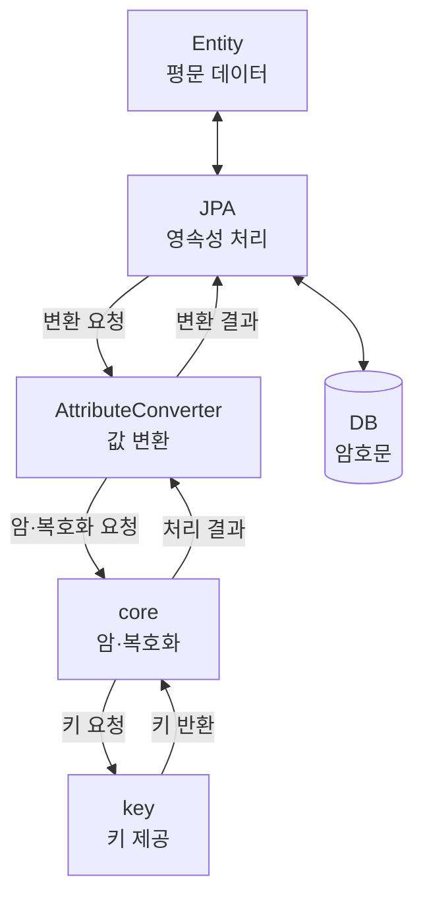

이전 포스팅에서는 애플리케이션 레벨에서 DB 컬럼 암호화를 구현하기 위해 `JPA`의 `AttributeConverter`를 선택한 이유를 살펴보았습니다.

이번에는 **비즈니스 로직과 암호화 처리 로직의 분리, 암·복호화 기능의 공통화**를 목표로 프로젝트 구조를 설계한 과정을 살펴보겠습니다. 이를 위해 암호화와 관련된 기능을 별도의 패키지로 구성하고, 각 구성 요소의 책임을 구분했습니다.

---

## 1. 프로젝트 구조

프로젝트는 크게 `api`, `domain`, `crypto`, `config` 패키지로 구분했습니다.

```text
├─ api
│  ├─ controller
│  └─ service
│
├─ domain
│  ├─ entity
│  └─ repository
│
├─ crypto
│  ├─ converter
│  ├─ core
│  ├─ key
│  └─ exception
│
└─ config
```

각 패키지의 역할은 다음과 같습니다.

| 패키지 | 역할 |
|---|---|
| `api` | 외부 요청을 처리하고 비즈니스 로직을 수행합니다. |
| `domain` | `Entity`와 `Repository`를 통해 도메인 데이터와 DB 접근을 관리합니다. |
| `crypto` | DB 컬럼 암호화에 필요한 데이터 변환, 암·복호화, 키 관리 기능을 담당합니다. |
| `config` | 애플리케이션 구동에 필요한 설정을 관리합니다. |

이번 프로젝트에서 가장 중요하게 생각한 부분은 `crypto` 패키지를 별도로 분리한 것입니다.

비즈니스 로직에서는 암·복호화 기능을 직접 호출하지 않고, JPA를 통한 데이터 저장과 조회 과정에서 암호화 처리가 이루어지도록 구성하고자 했습니다.

---

## 2. api 패키지

`api` 패키지는 외부 요청을 받아 비즈니스 로직을 수행하는 역할을 담당합니다.

| 하위 패키지 | 역할 |
|---|---|
| `controller` | HTTP 요청을 받아 서비스 계층으로 전달합니다. |
| `service` | 비즈니스 로직을 처리하고 Repository를 통해 데이터를 저장하거나 조회합니다. |

DB 컬럼 암호화의 동작을 확인하기 위해 아래와 같은 API를 구현했습니다.

| Method | URI | 설명 |
|---|---|---|
| POST | `/api/v1/account` | 계정 정보를 저장합니다. |
| GET | `/api/v1/account` | 전화번호를 조건으로 계정 정보를 조회합니다. |

API를 통해 전달되는 데이터는 애플리케이션의 비즈니스 처리 관점에서 평문을 기준으로 다룹니다.

암·복호화는 JPA의 데이터 변환 과정에서 수행되도록 구성했기 때문에 서비스 계층에서 암·복호화 메서드를 직접 호출할 필요는 없습니다.

다만 이러한 구조가 API 통신 구간의 데이터를 자동으로 보호하는 것은 아닙니다. 실제 서비스에서는 HTTPS를 비롯한 전송 구간 보호와 접근 통제도 별도로 고려해야 합니다.

또한 암호화된 전화번호를 조건으로 조회하는 기능은 암호화 방식에 따라 제약이 발생할 수 있으므로 실제 동작과 한계는 이후 포스팅에서 살펴보겠습니다.

---

## 3. domain 패키지

`domain` 패키지는 애플리케이션의 도메인 데이터와 DB 접근을 관리하는 영역입니다.

| 하위 패키지 | 역할 |
|---|---|
| `entity` | DB 테이블과 매핑되는 Entity를 정의합니다. |
| `repository` | Entity의 저장과 조회 등 데이터 접근을 담당합니다. |

비즈니스 로직과 Entity에서는 평문 형태의 데이터를 다루고, DB 컬럼에는 암호문이 저장되도록 구성하기 위해 암호화가 필요한 Entity 속성에 `@Convert` 어노테이션을 적용했습니다.

```java
@Convert(converter = StringEncryptConverter.class)
private String phoneNumber;
```

`StringEncryptConverter`는 JPA의 `AttributeConverter` 인터페이스를 구현한 클래스입니다.

이렇게 등록하면 JPA가 해당 속성의 값을 DB에 저장하거나 조회하는 과정에서 `StringEncryptConverter`를 통해 값 변환을 수행합니다.

따라서 Entity에 암·복호화 알고리즘을 직접 구현하거나, 서비스 계층에서 암·복호화 메서드를 호출할 필요가 없습니다.

다만 Entity는 `@Convert`를 통해 어떤 속성에 변환 기능을 적용할지 명시해야 합니다.

즉, **Entity는 암호화 대상 속성을 지정하고, 실제 암·복호화 처리는 별도의 구성 요소가 담당하도록 책임을 분리**했습니다.

---

## 4. crypto 패키지

`crypto` 패키지는 이번 프로젝트에서 DB 컬럼 암호화 기능을 담당하는 핵심 영역입니다.

암·복호화 기능을 하나의 클래스에 모두 구현할 수도 있지만, 그렇게 하면 JPA 연동부터 암호화 알고리즘과 키 관리까지 하나의 클래스가 책임지게 됩니다.

이러한 구조는 암호화 방식이나 키 관리 정책이 변경될 때 수정 범위가 커질 수 있다는 문제가 있습니다.

그래서 각 기능의 책임을 구분하여 다음과 같이 구성했습니다.

| 하위 패키지 | 역할 |
|---|---|
| `converter` | JPA의 `AttributeConverter` 구현체를 관리하고 데이터 변환을 연결합니다. |
| `core` | 실제 데이터의 암·복호화 처리를 담당합니다. |
| `key` | 암·복호화에 필요한 키를 제공하고 관리합니다. |
| `exception` | 암·복호화 과정에서 발생하는 예외를 정의합니다. |

### 4.1. converter와 core의 책임 분리

`converter`는 Entity 속성과 DB 컬럼 사이에서 값 변환이 필요한 시점에 호출되는 구성 요소입니다.

반면 `core`는 실제 암·복호화 알고리즘을 수행하는 역할을 담당합니다.

따라서 `converter`는 JPA의 데이터 변환 요청을 받아 암·복호화 처리를 `core`에 위임하고, 그 결과를 반환하는 역할에 집중하도록 설계했습니다.

이렇게 하면 암호화 알고리즘의 구현이 변경되더라도 JPA 연동을 담당하는 `converter`의 변경을 최소화할 수 있습니다.

### 4.2. key의 책임 분리

암호화 알고리즘과 암호화 키 관리 역시 서로 다른 책임으로 구분했습니다.

`core`는 암·복호화 처리를 담당하고, `key`는 이 과정에서 필요한 암호화 키를 제공하도록 책임을 분리했습니다.

이러한 구조라면 암호화 키의 저장 위치나 관리 방식을 변경하더라도 암·복호화 로직에 미치는 영향을 줄일 수 있습니다.

다만 키를 별도 패키지에서 관리한다고 해서 안전한 키 관리 체계가 자동으로 확보되는 것은 아닙니다. 실제 운영 환경에서는 키 저장소, 접근 권한, 교체와 복구 방안까지 고려해야 합니다.

### 4.3. 암·복호화 처리 흐름

지금까지 설명한 구성 요소의 책임과 호출 관계를 간략하게 정리하면 다음과 같습니다. 실제 DB 저장과 조회는 `JPA`가 담당하며 데이터 변환이 필요한 시점에는 `AttributeConverter`를 호출합니다.



이 구조의 핵심은 **각 구성 요소가 서로 다른 책임을 갖도록 분리한 것**입니다.

- `converter`는 JPA와 암호화 기능을 연결합니다.
- `core`는 실제 암·복호화 처리를 담당합니다.
- `key`는 암·복호화에 필요한 키를 제공합니다.

이렇게 구성하면 암호화 알고리즘이나 키 관리 방식의 변경이 다른 영역에 미치는 영향을 줄일 수 있을 것으로 판단했습니다.

---

## 5. config 패키지

`config` 패키지는 애플리케이션 구동에 필요한 설정을 관리하는 영역입니다. 

암호화 기능에 필요한 설정을 관리하기 위해 `CryptoProperties`와 `CryptoConfig` 클래스를 정의했습니다.

`CryptoProperties`는 DB 컬럼 암호화에 사용할 키를 Spring Boot의 설정 바인딩 기능을 통해 전달받는 클래스입니다.

```java
@Getter
@Setter
@ConfigurationProperties(prefix = "crypto")
public class CryptoProperties {
    private String base64Key;
}
```

`CryptoConfig`에서는 `@EnableConfigurationProperties`를 통해 `CryptoProperties`를 Spring Bean으로 등록하고 설정값이 바인딩되도록 구성했습니다.

```java
@Configuration
@EnableConfigurationProperties(CryptoProperties.class)
public class CryptoConfig {
    // 암호화 관련 설정
}
```

현재는 암호화 키를 Base64로 인코딩하여 설정 파일에서 읽어오도록 구현했습니다.

**Base64는 암호화가 아닌 인코딩 방식이므로 암호화 키를 보호하는 수단이 될 수 없습니다.**

이번 프로젝트에서는 암·복호화 기능의 구현과 동작 검증에 집중하기 위해 이러한 방식을 사용했지만, 실제 운영 환경에서는 별도의 키 관리 시스템이나 안전한 시크릿 관리 체계가 필요합니다.

---

## 6. 다음 포스팅

설계만으로 모든 보안 요구사항을 해결할 수 있는 것은 아닙니다. 실제 구현 과정에서는 암호화 알고리즘, 키 관리, 예외 처리와 같은 세부사항도 함께 고려해야 합니다.

다음 포스팅에서는 이번에 설계한 프로젝트 구조를 바탕으로 DB 컬럼 암호화 기능을 어떻게 구현했는지 실제 코드를 중심으로 살펴보겠습니다.

특히 `AttributeConverter`와 암·복호화 처리 기능을 어떻게 연결했는지 설명하겠습니다.