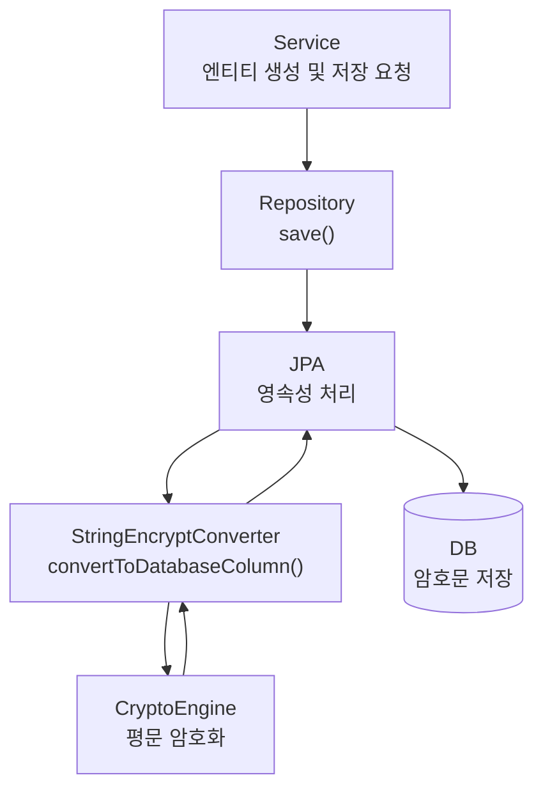
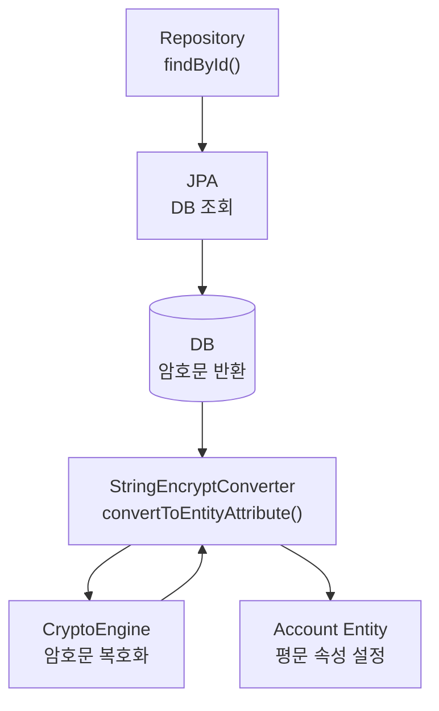
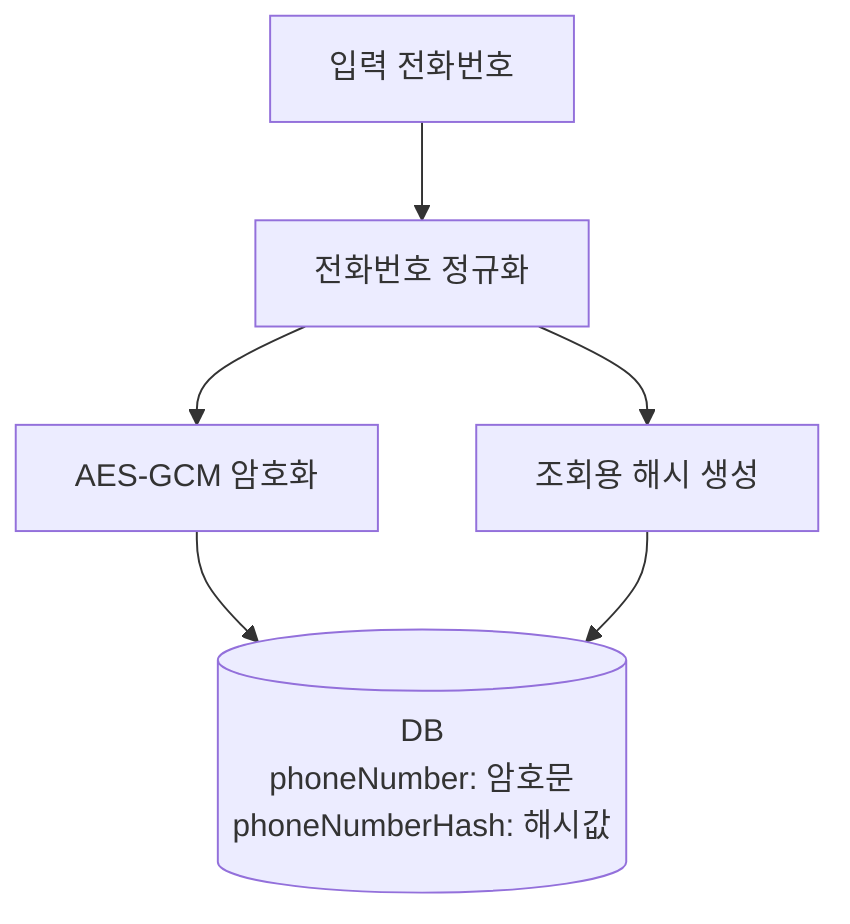
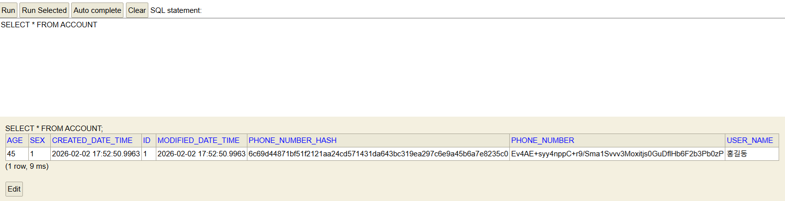

지금부터 이번 프로젝트에서 `AttributeConverter`, `CryptoEngine`, `KeyProvider`를 활용해 구현한 DB 컬럼 암호화 기능이 실제로 어떻게 동작하는지 확인해 보겠습니다.

---

## 1. DB 컬럼 암호화의 동작 검증

### 1.1. Account 엔티티 정의

암호화 기능을 검증하기 위한 목적으로 `Account` 엔티티를 다음과 같이 정의했습니다.

| 필드 | 데이터 타입 | 설명 | 암호화 |
|---|---|---|---|
| id | Long | 식별자 | X |
| phoneNumber | String | 전화번호 | O |
| userName | String | 이름 | X |
| sex | int | 성별 | X |
| age | int | 나이 | X |

전화번호(`phoneNumber`) 필드에 `@Convert`를 선언해 `StringEncryptConverter`를 적용했습니다. 이를 통해 데이터를 저장하거나 조회할 때 자동으로 암·복호화가 수행되도록 구성했습니다.

```java
@Entity
public class Account extends BaseEntity {

    @Id
    @GeneratedValue(strategy = GenerationType.IDENTITY)
    private Long id;

    @Convert(converter = StringEncryptConverter.class)
    private String phoneNumber;

    private String userName;
    private int sex;
    private int age;

    // 기타 코드 생략
}
```

### 1.2. 데이터 저장 시 암호화 흐름

서비스 계층에서는 일반적인 JPA 엔티티 저장 방식과 차이가 없습니다.

```java
Account account = Account.builder()
        .phoneNumber("01012345678")
        .userName("홍길동")
        .sex(1)
        .age(30)
        .build();

accountRepository.save(account);
```

`save()`를 호출한 이후 실제 SQL이 실행되는 과정에서 JPA는 `phoneNumber`의 값을 DB 컬럼에 저장할 형태로 변환합니다.

`@Convert`로 지정된 `StringEncryptConverter`가 이 과정에 참여하고, 이전 포스팅에서 구현한 `BaseEncryptConverter`를 통해 `CryptoEngine`의 암호화 기능이 호출됩니다.

전체 흐름은 다음과 같습니다.



이 과정에서 중요한 것은 **서비스 계층에서는 평문을 다루지만, DB의 암호화 대상 컬럼에는 암호문이 저장된다**는 점입니다.

다만 `save()`를 호출하는 즉시 SQL이 실행되는 것은 아닐 수 있습니다. 실제 저장 시점은 JPA의 영속성 관리와 `flush` 동작 등에 따라 달라질 수 있습니다.

### 1.3. 데이터 조회 시 복호화 흐름

조회 과정 역시 일반적인 JPA 사용 방식과 차이가 없습니다.

```java
Account account = accountRepository.findById(id)
        .orElseThrow();

String phoneNumber = account.getPhoneNumber();
```

DB에는 `phoneNumber`가 암호문으로 저장되어 있지만, JPA가 조회 결과를 엔티티에 매핑할 때 `AttributeConverter`를 통해 복호화가 수행됩니다.



복호화된 값은 `Account` 엔티티의 `phoneNumber` 속성에 설정됩니다.

따라서 서비스 계층에서는 암·복호화 과정을 직접 구현하거나 호출할 필요 없이 평문 데이터를 사용할 수 있습니다.

이렇게 **비즈니스 로직과 암·복호화 기능을 분리하는 것**이 이번 프로젝트에서 `AttributeConverter`를 선택한 가장 큰 이유였습니다.

---

## 2. 암호화 컬럼의 검색 제약

데이터를 저장하고 조회하는 과정에서 암·복호화 기능은 의도한 대로 동작하도록 구현할 수 있었습니다.

하지만 실제 서비스에서 사용하려면 한 가지 중요한 문제가 남아 있습니다.

바로 **암호화된 컬럼을 이용한 데이터 검색**입니다.

### 2.1. AES-GCM과 동등 비교 검색의 문제

이번 프로젝트에서 사용한 AES-GCM은 암호화할 때마다 새로운 Nonce를 생성합니다.

따라서 동일한 전화번호를 암호화하더라도 결과가 매번 달라질 수 있습니다.

예를 들어 다음과 같습니다.

| 평문 | 암호화 결과 |
|---|---|
| 01012345678 | 암호문 A |
| 01012345678 | 암호문 B |
| 01012345678 | 암호문 C |

<small>암호문 A, B, C는 동일한 평문을 서로 다른 Nonce로 암호화한 결과를 나타내는 예시입니다.</small>

이러한 특성 때문에 다음과 같은 SQL로는 전화번호를 직접 검색할 수 없습니다.

```sql
SELECT *
FROM account
WHERE phone_number = '01012345678';
```

DB에는 평문이 아닌 암호문이 저장되어 있기 때문입니다.

그렇다면 검색할 전화번호를 암호화해서 비교하면 될까요?

무작위로 생성된 Nonce를 사용하는 AES-GCM에서는 검색할 때마다 새로운 암호문이 생성되므로, 기존에 저장된 암호문과 값이 일치한다고 보장할 수 없습니다.

일반적인 `WHERE` 동등 비교나 인덱스 검색에 그대로 활용하기 어려운 이유입니다.

또한 암호문을 대상으로 한 `LIKE`나 접두어 검색도 평문의 문자열 검색과 동일하게 동작하지 않습니다.

이러한 제약은 `AttributeConverter` 자체의 문제라기보다는 **이번 프로젝트에서 선택한 암호화 방식의 특성**에서 비롯된 것입니다.

### 2.2. 조회용 해시 컬럼 도입

이 문제를 해결하기 위해 전화번호를 암호화하여 저장하는 컬럼과 조회에 사용하는 컬럼을 분리했습니다.

구현 방향은 다음과 같습니다.

1. 입력받은 전화번호를 정규화합니다.
2. 정규화된 전화번호로 조회용 해시값을 생성합니다.
3. 원본 전화번호는 AES-GCM으로 암호화해 저장합니다.
4. 전화번호 검색은 별도의 해시 컬럼을 기준으로 수행합니다.

이를 위해 `Account` 엔티티에 `phoneNumberHash` 필드를 추가했습니다.

| 필드 | 용도 |
|---|---|
| `phoneNumber` | AES-GCM으로 암호화한 전화번호 저장 |
| `phoneNumberHash` | 전화번호의 동등 비교 검색 및 중복 확인 |

동일한 전화번호를 항상 같은 방식으로 정규화하고 해시값을 생성한다면, 암호문이 달라지더라도 조회용 값은 일관되게 유지할 수 있습니다.

이렇게 하면 원본 전화번호의 저장 방식과 검색 방식을 분리할 수 있습니다.

다만 여기에는 중요한 보안상 고려사항이 있습니다.

**전화번호는 가능한 값의 범위가 제한적이므로 단순한 SHA-256 해시만으로는 충분한 보호를 기대하기 어렵습니다.**

공격자가 해시 컬럼을 확보한다면 가능한 전화번호들을 해시하여 비교하는 방식으로 원래 값을 추측할 수 있기 때문입니다.

이를 완화하기 위해서는 별도의 비밀 키를 사용하는 `HMAC-SHA-256`과 같은 방식을 고려할 수 있습니다.

이 경우 조회용 해시값의 생성 방식은 개념적으로 다음과 같습니다.

```text
phoneNumberHash = HMAC-SHA256(secretKey, normalizedPhoneNumber)
```

HMAC에 사용하는 비밀 키는 암호화 키와 별도로 관리하고, DB와 함께 유출되지 않도록 보호해야 합니다.

또한 일반적인 무작위 솔트를 각 행에 다르게 적용하는 방식은 동일한 입력에 동일한 조회용 값을 생성해야 하는 현재 검색 구조와는 맞지 않습니다.

이번 프로젝트에서 구현한 조회용 해시 구조 역시 실제 운영에 적용하려면 해시 생성 방식과 비밀 키 관리에 대한 검토가 필요합니다.

### 2.3. Account 엔티티 변경

조회용 해시 컬럼을 추가한 `Account` 엔티티의 주요 코드는 다음과 같습니다.

```java
@Getter
@NoArgsConstructor(access = AccessLevel.PROTECTED)
@Entity
@Table(
    uniqueConstraints = {
        @UniqueConstraint(
            name = "uk_account_phonenumber_hash",
            columnNames = "phoneNumberHash"
        )
    }
)
public class Account extends BaseEntity {

    @Id
    @GeneratedValue(strategy = GenerationType.IDENTITY)
    private Long id;

    @Convert(converter = StringEncryptConverter.class)
    @Column(nullable = false, length = 512)
    private String phoneNumber;

    @Column(nullable = false, length = 64)
    private String phoneNumberHash;

    private String userName;
    private int sex;
    private int age;

    @Builder
    public Account(
            String phoneNumber,
            String phoneNumberHash,
            String userName,
            int sex,
            int age) {

        this.phoneNumber = phoneNumber;
        this.phoneNumberHash = phoneNumberHash;
        this.userName = userName;
        this.sex = sex;
        this.age = age;
    }
}
```

`phoneNumberHash`에는 동일한 전화번호가 중복 등록되지 않도록 Unique 제약조건을 설정했습니다.

일반적인 관계형 DB에서는 Unique 제약조건을 지원하기 위한 인덱스가 생성되므로, 동일한 컬럼에 별도의 일반 인덱스를 추가하는 것은 중복일 수 있습니다.

이를 통해 다음과 같은 방식으로 데이터를 조회할 수 있습니다.

```sql
SELECT *
FROM account
WHERE phone_number_hash = ?;
```

이처럼 조회용 해시 컬럼을 사용하면 암호화된 전화번호를 직접 비교하지 않고도 정확히 일치하는 데이터를 검색할 수 있습니다.

다만 조회용 해시값에도 동일 입력 여부가 드러나는 특성이 있고, 전화번호와 연결된 개인정보로 취급해야 할 가능성이 있으므로 접근 통제가 필요합니다.

### 2.4. 서비스 계층의 조회 처리

서비스 계층에서는 전달받은 전화번호를 정규화한 후 조회용 해시값으로 변환합니다.

```java
@Transactional(readOnly = true)
public AccountResponse findByPhoneNumber(String phoneNumber) {

    String normalizedPhoneNumber =
            PhoneNumberNormalizer.normalize(phoneNumber);

    String hashNormalizedPhoneNumber =
            phoneNumberHashService.hashNormalizedPhoneNumber(
                    normalizedPhoneNumber);

    Account account = accountRepository
            .findByPhoneNumberHash(hashNormalizedPhoneNumber)
            .orElse(null);

    if (account == null) {
        return null;
    }

    return AccountResponse.of(account);
}
```

전화번호의 정규화는 검색 정확성을 확보하기 위한 중요한 과정입니다.

예를 들어 `010-1234-5678`과 `01012345678`은 같은 전화번호이므로 동일한 해시값이 생성되어야 합니다.

따라서 데이터를 저장할 때와 검색할 때 **반드시 같은 정규화 규칙과 해시 생성 방식을 사용해야 합니다.**

전체 저장 구조는 다음과 같습니다.



결과적으로 `phoneNumber`는 원본 데이터의 보호를 담당하고, `phoneNumberHash`는 정확한 값의 검색과 중복 확인을 담당합니다.

다만 이러한 방식은 **동등 비교 검색을 위한 해결책**이며, 부분 문자열 검색이나 범위 검색까지 해결하는 것은 아닙니다.

---

## 3. API를 통한 동작 확인

구현한 기능이 정상적으로 동작하는지 API와 H2 데이터베이스를 통해 확인했습니다.

### 3.1. 데이터 저장

다음과 같이 전화번호와 사용자 정보를 전달해 데이터를 저장했습니다.

```http
POST /api/v1/account
Content-Type: application/json

{
    "phoneNumber": "010-1234-5678",
    "userName": "홍길동",
    "sex": 1,
    "age": 45
}
```

응답 결과는 다음과 같습니다.

```json
{
    "code": 200,
    "status": "OK",
    "message": "OK",
    "data": {
        "id": 1,
        "phoneNumber": "01012345678",
        "userName": "홍길동",
        "sex": 1,
        "age": 45
    }
}
```

응답에서는 정규화된 전화번호를 확인할 수 있습니다.

하지만 실제 DB의 `phoneNumber` 컬럼에는 AES-GCM으로 암호화한 값이 저장됩니다.

### 3.2. 전화번호로 데이터 조회

다음으로 저장한 전화번호를 이용해 데이터를 조회했습니다.

```http
GET /api/v1/account?phoneNumber=01012345678
```

응답 결과는 다음과 같습니다.

```json
{
    "code": 200,
    "status": "OK",
    "message": "OK",
    "data": {
        "id": 1,
        "phoneNumber": "01012345678",
        "userName": "홍길동",
        "sex": 1,
        "age": 45
    }
}
```

서비스 계층에서는 입력받은 전화번호의 조회용 해시값을 생성하고, `phoneNumberHash`를 기준으로 데이터를 검색합니다.

조회한 엔티티의 `phoneNumber`는 `AttributeConverter`를 통해 복호화되므로 평문을 응답 데이터로 사용할 수 있습니다.

다만 이번 API는 동작 검증을 위한 예시입니다. 실제 운영 환경에서는 전화번호가 URL의 쿼리 파라미터에 포함될 경우 접근 로그 등에 남을 수 있다는 점도 고려해야 합니다.

또한 복호화된 전화번호를 API 응답에 그대로 노출할 것인지에 대해서도 별도의 인증·인가와 개인정보 노출 정책이 필요합니다.

### 3.3. DB 저장값 확인

H2 콘솔에서 실제 저장된 값을 확인했습니다.



API를 통해 조회한 전화번호는 평문으로 확인할 수 있지만, DB에는 암호화된 전화번호와 조회용 해시값이 각각 저장되는 구조입니다.

이를 통해 비즈니스 로직에서 암·복호화를 직접 호출하지 않아도 JPA의 데이터 변환 과정에서 자동으로 처리되는 것을 확인할 수 있었습니다.

---

## 4. 마무리

JPA의 `AttributeConverter`를 활용해 애플리케이션 레벨의 DB 컬럼 암호화 기능을 구현해봤습니다.

이번 프로젝트의 핵심은 **비즈니스 로직과 암·복호화 기능을 분리하고, JPA의 데이터 변환 과정을 통해 암·복호화를 자동으로 수행하도록 구성한 것**입니다.

무작위로 생성된 Nonce를 사용하는 AES-GCM의 특성으로 인해 암호화된 컬럼을 직접 검색하기 어렵다는 문제를 확인했고, 이를 해결하기 위해 조회용 해시 컬럼을 별도로 도입했습니다.

그러나 이러한 구현만으로 실제 운영 환경에서 필요한 보안 요구사항이 모두 충족되는 것은 아닙니다.

안전한 키 관리와 교체, 조회용 해시의 보호, 암·복호화 실패 처리, JPA를 거치지 않는 데이터 접근, 성능 및 운영 안정성 등에 대해서는 추가적인 검토가 필요합니다.

이번 프로젝트를 통해 **DB 컬럼 암호화는 단순히 데이터를 암호문으로 저장하는 것에서 끝나는 문제가 아니라, 데이터의 저장과 조회 방식까지 함께 설계해야 하는 문제**라는 점을 확인할 수 있었습니다.

---

## 5. 소스 코드

- [JPA Crypto Converter](https://github.com/sanghoon-lee/jpa-crypto-converter)