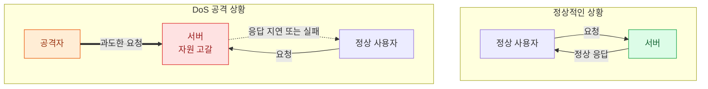

개인정보 유출이나 해킹 사고와 관련된 소식이 자주 들리면서 제가 담당하고 있는 서비스는 과연 안전한지 걱정이 되곤 합니다.

하지만 언제까지 걱정만 하고 있을 수는 없는 노릇입니다. 서비스 보안을 강화하기 위해 다양한 시도를 해봐야겠지만, 그 시작은 **개발자가 안전하게 코드를 작성하는 것**이어야 한다고 생각했습니다.

그래서 안전한 코드를 작성하기 위한 기본 원칙부터 다시 공부해보고 싶었습니다. 이를 위해 학습 교재로 선택한 것은 Oracle에서 제공하는 [Oracle Secure Coding Guidelines for Java SE](https://www.oracle.com/java/technologies/javase/seccodeguide.html)입니다.

Oracle Secure Coding Guidelines for Java SE는 Java 애플리케이션을 안전하게 개발하기 위해 고려해야 할 보안 원칙과 권장 사항을 정리한 문서입니다.

개발 과정에서 어떤 코드가 보안 문제를 일으킬 수 있고 이를 예방하기 위해 무엇을 주의해야 하는지 설명하고 있습니다.

여러 주제를 다루고 있는데 이번 시리즈에서 살펴볼 서비스 거부(DoS, Denial of Service) 취약점도 그중 하나입니다.

---

## 1. 서비스 거부(DoS) 취약점

DoS(Denial of Service)는 우리말로 서비스 거부를 의미하며 정상적인 사용자가 서비스를 이용하지 못하도록 만드는 공격을 말합니다.

대표적인 사례는 서버가 처리할 수 있는 양보다 많은 요청을 보내 CPU, 메모리, 네트워크 등의 자원을 고갈시키는 것입니다. 서버가 공격자의 요청을 처리하는 데 자원을 소모하면서 정상적인 사용자의 요청을 처리하지 못하게 되는 것입니다.

정상적인 상황에서는 서버가 사용자의 요청을 처리하고 응답을 반환합니다. 하지만 공격자가 과도한 요청을 발생시키면 서버의 처리 능력이 한계에 도달할 수 있습니다. 이 경우 정상적인 사용자의 요청도 지연되거나 처리되지 못하는 상황이 발생합니다.

이처럼 정상적인 사용자가 서비스를 이용하지 못하도록 만드는 것이 DoS 공격의 핵심입니다.

여러 시스템에서 동시에 공격을 수행하는 DDoS(Distributed Denial of Service)도 서비스 거부 공격의 일종입니다. 그런데 서비스 거부 공격이 반드시 대량의 네트워크 트래픽을 필요로 하는 것은 아닙니다.

애플리케이션에서 자원을 적절히 관리하지 못하거나 잘못된 입력값을 처리하는 과정에서도 서비스 거부 취약점이 발생할 수 있습니다.

---

## 2. 잘못된 코드 구현으로 발생할 수 있는 DoS 취약점

앞서 살펴본 것처럼 DoS는 대량의 네트워크 트래픽을 발생시키는 공격으로 많이 알려져 있습니다. 하지만 개발자가 작성한 코드에 문제가 있다면 공격자가 많은 요청을 보내지 않더라도 서비스 장애가 발생할 수 있습니다.

예를 들어 다음과 같은 경우입니다.

* 메모리 고갈: 외부에서 전달받은 입력값에 따라 과도한 메모리를 할당하는 경우

* CPU 과다 사용: 특정 입력값으로 인해 무한 루프가 발생하거나 복잡한 연산이 반복되는 경우

* 자원 누수: 파일이나 DB 커넥션 등의 자원을 사용한 후 적절하게 반환하지 않는 경우

* 정수 오버플로: 자원 사용량을 검사하는 과정에서 정수 오버플로가 발생하여 제한 조건을 우회하는 경우

이러한 문제는 평소 정상적인 입력값으로 테스트할 때는 쉽게 드러나지 않을 수도 있습니다. 하지만 공격자가 의도적으로 비정상적인 입력값을 전달하거나 특정 요청을 반복하면 서버의 자원이 고갈되어 정상적인 요청을 처리하지 못하는 상황이 발생할 수 있습니다.

결국 서비스 거부 취약점을 예방하기 위해서는 정상적인 상황뿐 아니라 비정상적인 입력값과 예외 상황까지 고려하여 코드를 작성해야 합니다.

---

## 3. 다음 포스팅

애플리케이션의 잘못된 코드 구현으로 발생할 수 있는 DoS 취약점을 예방하려면 서버 자원이 어떻게 사용되는지 이해하고, 비정상적인 입력이나 예외적인 상황에서도 안전하게 동작하도록 코드를 작성해야 합니다.

다음 포스팅에서는 Oracle Secure Coding Guidelines for Java SE에서 다루는 DoS 관련 첫 번째 항목인 과도한 자원 소비를 유발하지 말 것에 대해 살펴보려고 합니다. 입력값 검증이 왜 중요한지, 그리고 어떤 코드가 메모리나 CPU 자원을 과도하게 소모하게 만들 수 있는지 Java 예제를 통해 정리해보겠습니다.