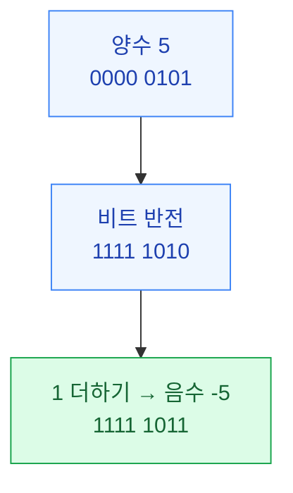
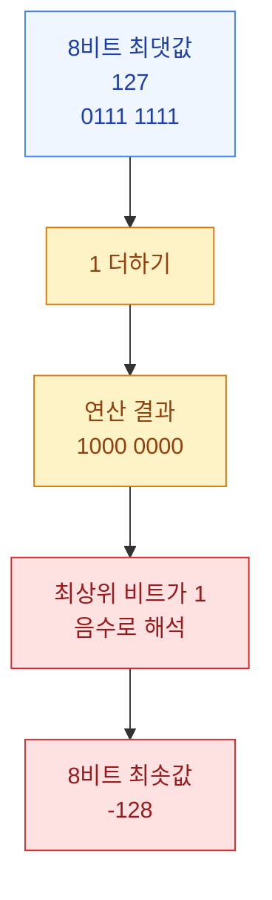

앞선 포스팅에서는 Oracle의 세 번째 DoS 보안 지침인 **DOS-3: Resource limit checks should not suffer from integer overflow**를 살펴보면서 정수 오버플로로 인해 자원 사용량 검증이 우회될 수 있다는 사실을 알아봤습니다.

그 과정에서 `Long.MAX_VALUE`에 1을 더하면 최솟값인 음수로 바뀌는 현상을 확인했습니다.

```java
long value = Long.MAX_VALUE;

System.out.println(value);     // 9223372036854775807
System.out.println(value + 1); // -9223372036854775808
```

그렇다면 **최댓값에 1을 더했을 뿐인데 왜 최솟값인 음수로 바뀌는 것일까요?** 

그 이유를 조금 더 자세히 설명하면 좋을 것 같아서 Java에서 사용하는 **2의 보수(2's Complement)** 표현 방식에 대해서 추가적으로 포스팅하게 되었습니다.

---

## 1. 컴퓨터는 음수를 어떻게 표현할까?

컴퓨터는 데이터를 0과 1로 이루어진 비트(Bit)로 표현합니다.

양수는 이진수로 쉽게 표현할 수 있지만, 음수를 표현하려면 별도의 규칙이 필요합니다.

가장 직관적인 방법은 최상위 비트를 부호로 사용하는 것입니다. 예를 들어 8비트에서 최상위 비트가 0이면 양수, 1이면 음수로 정하면 다음과 같습니다.

```text
0000 0101 =  5
1000 0101 = -5
```

이를 부호와 절댓값(Sign-Magnitude) 방식이라고 합니다.

하지만 이 방식은 양수 0과 음수 0이 따로 존재하며, 부호가 다른 숫자끼리 덧셈할 때도 별도의 처리가 필요합니다.

이러한 문제를 해결하기 위해 사용하는 표현 방법 중 하나가 **2의 보수 방식**입니다.

Java의 `byte`, `short`, `int`, `long`도 2의 보수 방식으로 부호 있는 정수를 표현합니다.

---

## 2. 2의 보수란?

2의 보수는 정해진 비트 수 안에서 양수와 음수를 표현하는 방법입니다.

양수를 음수로 변환할 때는 다음 두 단계를 이용할 수 있습니다.

1. 모든 비트를 반전합니다.
2. 반전한 결과에 1을 더합니다.

예를 들어 8비트에서 `5`를 `-5`로 변환하면 다음과 같습니다.



2의 보수 방식에서는 이렇게 표현한 음수도 일반적인 이진수 덧셈으로 계산할 수 있습니다.

예를 들어 5와 -5를 더하면 다음과 같습니다.

```text
    0000 0101    5
  + 1111 1011   -5
  ------------
  1 0000 0000
    └───────┘
      8비트 결과
```

8비트를 넘어서는 자리올림을 버리면 결과는 `0000 0000`, 즉 0이 됩니다.

이처럼 **2의 보수 방식에서는 양수와 음수를 동일한 이진수 덧셈 방식으로 처리할 수 있다는 장점**이 있습니다.

---

## 3. 최댓값에 1을 더하면 왜 음수가 될까?

8비트 2의 보수에서 표현할 수 있는 정수의 범위는 -128부터 127까지입니다.

최상위 비트가 0이면 0 이상의 값이고, 1이면 음수를 나타냅니다.

| 비트 패턴 | 십진수 |
|---|---:|
| `0000 0000` | 0 |
| `0000 0001` | 1 |
| `0111 1111` | 127 (최댓값) |
| `1000 0000` | -128 (최솟값) |
| `1111 1111` | -1 |

그렇다면 최댓값인 127에 1을 더하면 어떻게 될까요?



수학적으로는 127 + 1 = 128이지만, 8비트 부호 있는 정수로는 128을 표현할 수 없습니다.

따라서 결과의 비트 패턴인 `1000 0000`이 2의 보수 방식에서 -128로 해석되는 것입니다.

Java의 `int`나 `long`에서도 같은 원리가 적용됩니다.

예를 들어 `int`는 32비트 부호 있는 정수형이므로 다음과 같은 결과가 발생합니다.

```java
int value = Integer.MAX_VALUE;

System.out.println(value);     // 2147483647
System.out.println(value + 1); // -2147483648
```

Java의 `int`나 `long`에서 정수 오버플로가 발생하면 표현 가능한 비트 수를 초과한 부분이 버려지면서 수학적인 계산 결과와 다른 값이 만들어집니다.

---

## 4. Java에서 직접 확인해 보기

앞에서는 이해를 돕기 위해 8비트를 기준으로 설명했습니다.

그런데 Java의 `byte` 타입으로 같은 현상을 확인하려면 주의할 점이 있습니다.

Java에서는 `byte` 타입에 덧셈 연산을 수행할 때 `int` 타입으로 변환한 후 계산하기 때문입니다.

```java
byte value = 127;

System.out.println(value + 1);         // 128
System.out.println((byte) (value + 1)); // -128
```

첫 번째 연산에서는 `int` 타입으로 계산하기 때문에 128이 출력됩니다.

두 번째 연산에서는 덧셈 결과를 다시 `byte` 타입으로 변환하면서 하위 8비트만 남게 됩니다. 이 비트 패턴은 2의 보수 방식에서 -128을 나타냅니다.

반면 `int`와 `long`에서는 형변환 없이도 앞서 살펴본 정수 오버플로가 발생합니다.

중요한 점은 **Java에서 일반적인 정수 덧셈 중 오버플로가 발생하더라도 자동으로 예외가 발생하지 않는다는 것**입니다.

--- 

## 5. 마무리

이러한 특성을 이해하지 못하면 정수 오버플로로 인해 잘못된 계산 결과를 정상적인 값으로 판단할 수 있습니다. 특히 앞선 DOS-3 포스팅에서 살펴본 것처럼 자원 사용량 검증이 우회되는 보안 문제로도 이어질 수 있습니다.

오래전 스마트카드 운영체제인 COS(Card Operating System)와 Java Card Virtual Machine을 개발하던 시절에는 지금처럼 코딩 테스트가 일반적이지 않았습니다.

당시 신입 개발자 채용 면접에서 정수 오버플로와 관련된 문제를 종종 출제하곤 했습니다. 예상하지 못한 질문에 당황하던 지원자들의 모습이 아직도 생생합니다. 지금 생각해 보면 조금 짓궂은 면접관이었던 것 같기도 합니다.

