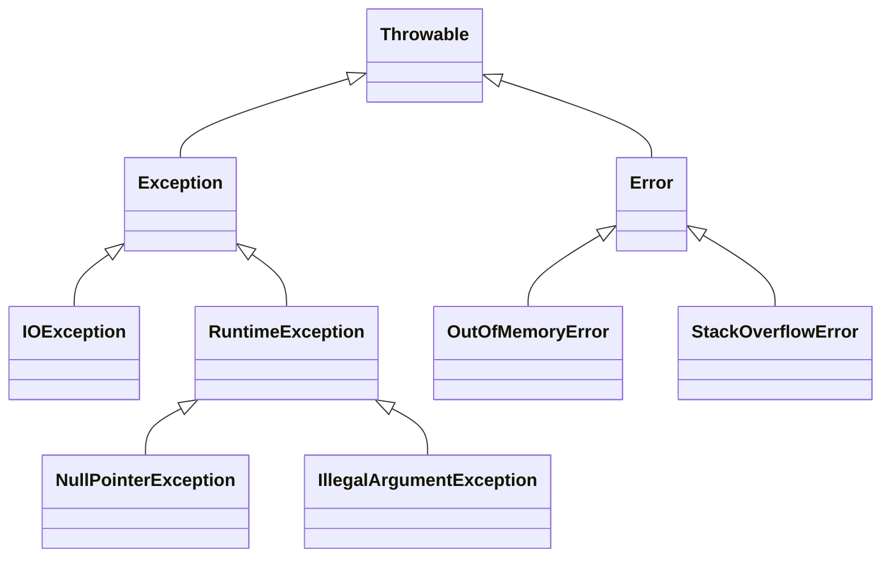

앞선 포스팅에서는 Oracle의 네 번째 DoS 보안 지침인 **DOS-4: Implement Robust Error/Exceptions handling for services**를 통해 예외 처리와 예외 전파의 차이, 그리고 서비스 안정성을 유지하기 위한 예외 처리 방법을 살펴봤습니다.

그 과정에서 Java의 `Throwable`에는 `Exception`뿐 아니라 `Error`도 포함된다는 내용을 접했습니다. 오래전에 어렴풋이 배웠던 내용이지만, 다른 사람에게 자신 있게 설명할 수 있을 정도로 개념이 명확하게 정리되어 있지는 않았습니다.

그래서 추가적으로 Java의 `Throwable` 상속 구조를 살펴보고 `Exception`과 `Error`는 어떤 차이가 있는지 정리해봤습니다.

---

## 1. Throwable, Exception, Error의 관계

`Throwable`은 Java에서 `throw` 문으로 던지거나 `catch` 블록에서 처리할 수 있는 객체의 최상위 클래스입니다. Java에서 발생하는 `Exception`과 `Error`는 모두 `Throwable` 클래스를 상속합니다.

- **`Exception`:** 애플리케이션 실행 중 발생할 수 있는 예외를 표현하는 클래스
- **`Error`:** 일반적인 애플리케이션에서 복구하기 어려운 심각한 오류를 표현하는 클래스

`Exception`과 `Error` 클래스의 상속 관계를 간단하게 표현하면 다음과 같습니다.



위 그림에서 확인할 수 있듯이 `Exception`과 `Error`는 서로 상속하는 관계가 아니라, **동일한 부모 클래스인 `Throwable`을 상속받은 별개의 클래스**입니다.

`IOException`과 `RuntimeException`은 `Exception`을 상속받으며, `NullPointerException`과 `IllegalArgumentException`은 `RuntimeException`을 상속받습니다.

이들은 모두 예외를 표현하는 클래스로 `Exception`의 하위 클래스가 됩니다. 반면 `OutOfMemoryError`,`StackOverflowError` 등 오류를 표현하는 클래스는 `Error`를 상속받고 있습니다.

이처럼 Java에서는 예외와 오류를 클래스 계층으로 구분하고 있습니다. 

이러한 구분은 단순히 오류의 종류를 분류하기 위한 것이 아니라, **발생한 문제를 애플리케이션에서 어떻게 다룰 것인지 판단하는 기준**이 됩니다.

---

---

## 2. Exception과 Error의 차이

앞서 살펴본 것처럼 `Exception`과 `Error`는 모두 `Throwable`을 상속하지만, 서로 다른 목적을 가지고 있습니다.

`Exception`은 애플리케이션 실행 중 발생할 수 있는 예외 상황을 표현하는 것으로 개발자가 적절한 처리를 통해 복구하거나 대응할 수 있는 문제를 나타냅니다.

반면 `Error`는 일반적인 애플리케이션 코드에서 복구하기 어려운 심각한 문제를 나타냅니다.

두 클래스의 대표적인 차이를 정리하면 다음과 같습니다.

| 구분 | Exception | Error |
|---|---|---|
| 의미 | 애플리케이션에서 처리할 수 있는 예외 상황 | 일반적으로 복구하기 어려운 심각한 오류 |
| 대표 클래스 | `IOException`, `NullPointerException` | `OutOfMemoryError`, `StackOverflowError` |
| 처리 방식 | 상황에 따라 복구하거나 상위 호출자로 전파 | 일반적으로 직접 복구를 시도하지 않음 |
| JVM 종료 여부 | 예외 발생 자체가 JVM 종료를 의미하지 않음 | 오류 발생 자체가 JVM 종료를 의미하지 않음 |

### 2.1. Exception은 어떤 상황에서 발생할까?

`Exception`은 파일 입출력 실패, 잘못된 입력값, 프로그램 실행 중 발생하는 오류 등 다양한 상황에서 사용됩니다.

대표적인 예외는 다음과 같습니다.

- **`IOException`:** 파일이나 네트워크 입출력 과정에서 문제가 발생한 경우
- **`NullPointerException`:** `null` 객체를 참조하여 메서드나 필드 등에 접근하려는 경우
- **`IllegalArgumentException`:** 메서드에 전달된 인자가 적절하지 않은 경우

예를 들어 파일을 읽는 과정에서 `IOException`이 발생하면 재시도하거나 대체 데이터를 반환하는 등의 방법을 고려할 수 있습니다.

물론 모든 `Exception`을 복구할 수 있는 것은 아닙니다. 예외의 원인과 애플리케이션의 상태에 따라 복구가 불가능할 수도 있습니다.

### 2.2. Error는 어떤 상황에서 발생할까?

`Error`는 일반적인 애플리케이션 코드에서 복구하기 어려운 심각한 문제를 나타냅니다.

대표적인 오류는 다음과 같습니다.

- **`OutOfMemoryError`:** JVM이 필요한 메모리를 확보하지 못하는 경우
- **`StackOverflowError`:** 메서드 호출 등이 반복되어 스레드의 스택 공간이 부족해진 경우
- **`NoClassDefFoundError`:** 실행 시 필요한 클래스의 정의를 JVM이 찾거나 사용할 수 없는 경우

예를 들어 `OutOfMemoryError`가 발생했다면 단순히 오류를 잡아 처리하더라도 정상적인 애플리케이션 동작을 보장하기 어렵습니다.

그렇다면 `Error`가 발생하면 JVM이 반드시 종료될까요?

**그렇지는 않습니다.**

`Error` 역시 `Throwable`의 하위 클래스이므로 호출 스택을 따라 전파됩니다. 처리되지 않은 오류가 스레드의 최상위 영역까지 전파되면 해당 스레드가 종료될 수 있습니다. 하지만 이것이 반드시 JVM 전체의 종료를 의미하지는 않습니다.

다만 `OutOfMemoryError`와 같이 시스템 자원이 부족한 상황에서는 다른 작업에도 영향을 미칠 수 있으므로 정상적인 서비스 운영이 어려워질 수 있습니다.

따라서 **`Error`가 발생했다고 무조건 JVM이 종료되는 것은 아니지만, 애플리케이션이 안전하게 동작할 수 있는 상태인지 판단은 필요합니다.**

### 2.3. Checked Exception과 Unchecked Exception

여기서 한 가지 더 알아둘 개념이 있습니다.

Java에서는 예외를 컴파일 시점에 처리 여부를 검사하는지에 따라 `Checked Exception`과 `Unchecked Exception`으로 구분합니다.

- **Checked Exception:** `IOException`처럼 컴파일러가 예외 처리 또는 `throws` 선언을 요구하는 예외
- **Unchecked Exception:** `RuntimeException`과 그 하위 클래스, 그리고 `Error`와 그 하위 클래스처럼 컴파일러가 예외 처리나 `throws` 선언을 요구하지 않는 예외

특히 `Error`도 컴파일러의 예외 처리 강제 대상에서 제외된다는 점이 흥미롭습니다.

이는 `Error`가 `Exception`을 상속하기 때문이 아니라, Java의 컴파일 시점 예외 검사 규칙에서 `RuntimeException`과 `Error`를 모두 검사 대상에서 제외하기 때문입니다.

중요한 것은 `Unchecked Exception`이라는 표현을 사용한다고 해서 모두 `Exception`의 하위 클래스인 것은 아니라는 점입니다.

이러한 차이를 이해하면 다음 목차에서 살펴볼 `catch (Exception)`과 `catch (Throwable)`의 동작 차이도 쉽게 이해할 수 있습니다.

---

---

## 3. catch (Exception)과 catch (Throwable)의 차이

Java의 `catch` 블록은 선언한 예외 타입뿐 아니라, 해당 타입을 상속하는 하위 클래스의 객체도 처리할 수 있습니다.

따라서 `catch (Exception)`과 `catch (Throwable)`은 처리할 수 있는 대상에 차이가 있습니다.

### 3.1. catch (Exception)은 Error를 처리할 수 없다

먼저 `catch (Exception)`을 사용하는 예제입니다.

```java
public static void main(String[] args) {
    try {
        throw new IllegalArgumentException("잘못된 입력값");
    } catch (Exception e) {
        System.out.println("Exception 처리: " + e.getMessage());
    }
}
```

실행 결과는 다음과 같습니다.

```text
Exception 처리: 잘못된 입력값
```

`IllegalArgumentException`은 `RuntimeException`을 상속하고, `RuntimeException`은 다시 `Exception`을 상속하기 때문에 `catch (Exception)`에서 처리할 수 있습니다.

그렇다면 `Error`를 발생시키면 어떻게 될까요?

```java
public static void main(String[] args) {
    try {
        throw new AssertionError("오류 발생");
    } catch (Exception e) {
        System.out.println("Exception 처리: " + e.getMessage());
    }
}
```

이번에는 `catch (Exception)` 블록이 실행되지 않습니다.

`AssertionError`는 `Error`의 하위 클래스이므로 `Exception`으로 처리할 수 없기 때문입니다.

결국 처리되지 않은 `AssertionError`는 `main()` 메서드 밖으로 전파됩니다.

### 3.2. catch (Throwable)은 Exception과 Error를 모두 처리할 수 있다

이번에는 `catch (Throwable)`을 사용해 보겠습니다.

```java
public static void main(String[] args) {
    try {
        throw new AssertionError("오류 발생");
    } catch (Throwable e) {
        System.out.println("Throwable 처리: " + e.getMessage());
    }
}
```

실행 결과는 다음과 같습니다.

```text
Throwable 처리: 오류 발생
```

`AssertionError` 역시 `Throwable`의 하위 클래스이기 때문에 정상적으로 `catch` 블록에서 처리됩니다.

즉, **`catch (Exception)`은 `Exception` 계열만 처리하지만, `catch (Throwable)`은 `Exception`과 `Error` 계열을 모두 처리할 수 있습니다.**

이를 정리하면 다음과 같습니다.

| 발생한 객체 | catch (Exception) | catch (Throwable) |
|---|---|---|
| `IOException` | 처리 가능 | 처리 가능 |
| `NullPointerException` | 처리 가능 | 처리 가능 |
| `IllegalArgumentException` | 처리 가능 | 처리 가능 |
| `AssertionError` | 처리 불가 | 처리 가능 |
| `OutOfMemoryError` | 처리 불가 | 처리 가능 |

### 3.3. 처리할 수 있다는 것이 복구할 수 있다는 의미는 아니다

여기서 주의해야 할 점이 있습니다.

`catch (Throwable)`을 사용하면 `Error`까지 잡을 수 있지만, **오류를 잡았다고 해서 애플리케이션이 정상적으로 복구되었다는 의미는 아닙니다.**

앞선 예제에서는 단순히 `AssertionError`를 발생시켰기 때문에 문제가 없어 보일 수 있습니다.

하지만 실제로 `OutOfMemoryError`가 발생한 상황이라면 메모리가 부족한 상태이므로 오류를 잡더라도 이후 작업이 정상적으로 실행된다고 보장할 수 없습니다.

따라서 일반적인 애플리케이션 코드에서는 `catch (Throwable)`을 무분별하게 사용하기보다 필요한 예외를 적절한 위치에서 처리하는 것이 좋습니다.

이러한 내용은 앞선 DOS-4 지침과도 연결됩니다. 개별 작업의 실패가 다른 작업에 영향을 미치지 않도록 예외를 처리해야 하지만, 복구하기 어려운 오류가 발생했다면 이후 작업을 계속 수행하는 것이 안전한지도 판단해야 합니다.

결국 **예외나 오류를 잡을 수 있는지와 실제로 복구할 수 있는지는 구분해서 생각해야 합니다.**