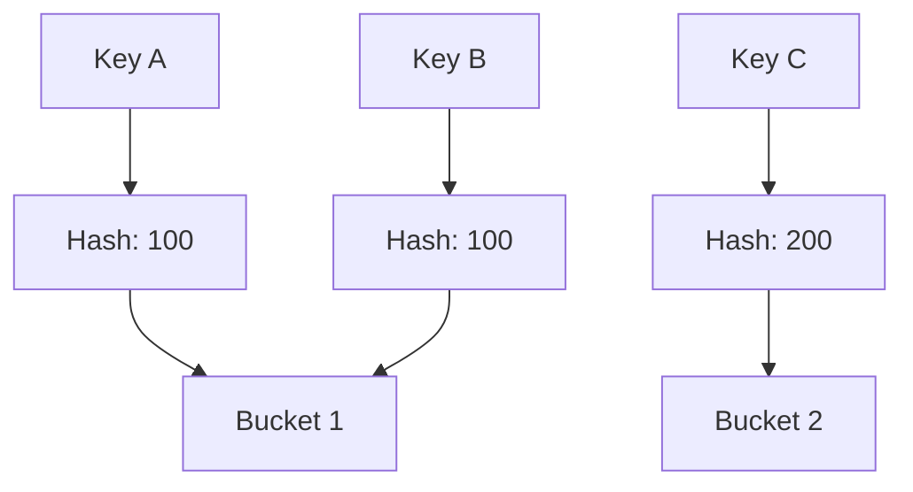

앞선 포스팅에서는 예외 처리와 예외 전파의 차이를 살펴보고, 예외가 서비스 안정성에 미치는 영향을 알아봤습니다.

Java에서 자주 사용하는 `HashMap`과 `HashSet`도 외부 입력값을 Key로 사용하는 과정에서 해시 충돌이 과도하게 발생하면 서비스 거부 취약점으로 이어질 수 있다고 합니다.

이번 포스팅에서는 Oracle Secure Coding Guidelines for Java SE의 다섯 번째 DoS 보안 지침인 **DOS-5: Avoid using user input as hash keys**를 통해 **해시 충돌이 발생하는 원리와 성능에 미치는 영향, 그리고 이를 예방하기 위한 방법**을 알아보겠습니다.

---

## 1. DOS-5: Avoid using user input as hash keys

Oracle의 다섯 번째 DoS 보안 지침인 **DOS-5: Avoid using user input as hash keys**는 외부 사용자가 제어할 수 있는 데이터를 `HashMap`, `HashSet`과 같은 해시 기반 자료구조의 Key로 사용하지 않도록 권고합니다.

해시 기반 자료구조는 Key의 해시값을 이용해 데이터를 저장하고 조회합니다. 일반적인 상황에서는 빠르게 데이터를 처리할 수 있지만, 서로 다른 Key가 동일한 해시값을 가지면 해시 충돌(Hash Collision)이 발생합니다.

해시 충돌 자체가 문제는 아닙니다. 하지만 충돌이 지나치게 많이 발생하면 데이터를 저장하거나 조회하는 과정에서 추가적인 연산이 필요해 성능이 저하될 수 있습니다.

특히 공격자가 의도적으로 해시 충돌을 유발하는 입력값을 대량으로 전달한다면 CPU 자원이 과도하게 사용되어 정상적인 서비스 처리에도 영향을 미칠 수 있습니다.

이러한 공격을 **해시 충돌 공격(Hash Collision Attack)**이라고 합니다.

---

## 2. 해시 충돌과 서비스 거부 취약점

`HashMap`은 Key의 `hashCode()`를 이용해 해시값을 계산하고, 이를 바탕으로 데이터를 저장할 Bucket의 위치를 결정합니다.

하지만 서로 다른 Key가 동일한 해시값을 가질 수 있으며, 해시값이 다르더라도 같은 Bucket에 배치될 수 있습니다.

이러한 해시 충돌을 간단하게 표현하면 다음과 같습니다.

위 그림에서 `Key A`와 `Key B`는 동일한 해시값을 가지므로 같은 Bucket에 저장됩니다.

연결 리스트 방식으로 데이터를 관리하는 해시 테이블에서는 하나의 Bucket에 많은 Key가 집중되면 원하는 Key를 찾기 위해 여러 Key를 순서대로 비교해야 할 수 있습니다.

예를 들어 하나의 Bucket에 100개의 Key가 저장되어 있다면, 원하는 Key를 찾기 위해 최대 100번의 비교 작업이 필요할 수 있습니다.

이처럼 해시 충돌이 많아질수록 데이터를 저장하거나 조회하는 데 필요한 작업량이 증가하여 성능이 저하될 수 있습니다.

다만 **Java 8 이후의 `HashMap`은 충돌이 많은 Bucket을 트리 구조로 전환하여 성능 저하를 완화하는 기능을 제공**합니다.

따라서 Java의 `HashMap`에서 해시 충돌이 발생한다고 해서 반드시 심각한 성능 저하로 이어지는 것은 아닙니다.

하지만 이러한 개선 기능이 모든 상황에서 성능 문제를 방지해 주는 것은 아니므로, 외부 입력값을 Key로 사용할 때는 주의가 필요합니다.

---

## 3. 해시 충돌로 인한 DoS 예방 방법

Oracle에서는 해시 충돌 공격의 위험을 줄이기 위해 외부 사용자가 제어하는 데이터를 해시 기반 자료구조의 Key로 사용하지 않도록 권고합니다.

또한 Key가 `Comparable`을 구현하여 비교 가능한 구조를 갖추고 해시 함수의 계산 시간이 입력 데이터에 따라 지나치게 증가하지 않도록 고려할 것을 권고합니다.

여기서 `Comparable`은 **객체 사이의 크기나 순서를 비교할 수 있도록 정의하는 Java 인터페이스**입니다.

`Comparable`을 구현한 클래스는 `compareTo()` 메서드를 통해 두 객체의 순서를 비교할 수 있습니다. 예를 들어 Java의 `String` 클래스는 이미 `Comparable`을 구현하고 있어 문자열을 사전순으로 비교할 수 있습니다.

그렇다면 이것이 해시 충돌과 어떤 관계가 있을까요?

Java 8 이후의 `HashMap`은 특정 Bucket에 해시 충돌이 집중되면 데이터를 트리 구조로 관리할 수 있습니다. 이때 동일한 해시값을 가진 Key들이 서로 비교 가능한 Comparable 객체라면, HashMap은 compareTo()를 이용해 Key의 순서를 결정하고 탐색 성능을 개선할 수 있습니다.

즉, **`Comparable`은 해시 충돌 자체를 방지하는 기능이 아니라, 충돌이 발생했을 때 성능 저하를 완화하는 데 도움을 줄 수 있는 기능**입니다.

실제 애플리케이션에서는 다음과 같은 방법도 함께 고려할 수 있습니다.

- **신뢰할 수 있는 Key 사용:** 가능한 경우 외부 입력값 대신 서버에서 관리하는 식별자를 Key로 사용합니다.
- **입력 데이터 제한:** 외부에서 전달받는 데이터의 길이와 개수를 제한합니다.
- **자료구조 특성 확인:** 해시 충돌이 발생했을 때 사용하는 자료구조가 어떻게 동작하는지 확인합니다.

여기서 중요한 것은 단순히 `String` 대신 다른 객체를 Key로 사용한다고 해서 안전해지는 것은 아니라는 점입니다.

**중요한 것은 Key의 자료형이 아니라, 외부 사용자가 Key의 값이나 생성 과정을 얼마나 제어할 수 있는지입니다.**

결국 해시 충돌 공격에 대응하려면 자료구조의 특성을 이해하고, 외부 입력값 검증과 자원 사용량 제한을 함께 고려해야 합니다.

---

## 4. 마무리

이번 DOS-5 지침을 통해 평소 익숙하게 사용하던 `HashMap`과 같은 자료구조도 사용 방법에 따라 서비스 거부 취약점과 연결될 수 있다는 사실을 알게 되었습니다.

특히 **자료구조의 사용 방법뿐 아니라 내부 동작 원리와 입력 데이터가 처리 성능에 미치는 영향까지 이해하는 것이 중요하다**는 점을 다시 한번 느꼈습니다.

이것으로 Oracle Secure Coding Guidelines for Java SE의 DoS 관련 다섯 가지 보안 지침을 모두 살펴봤습니다.