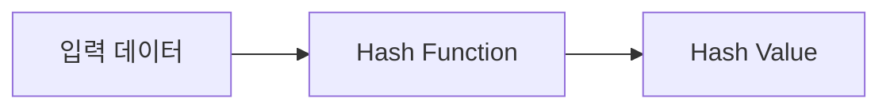
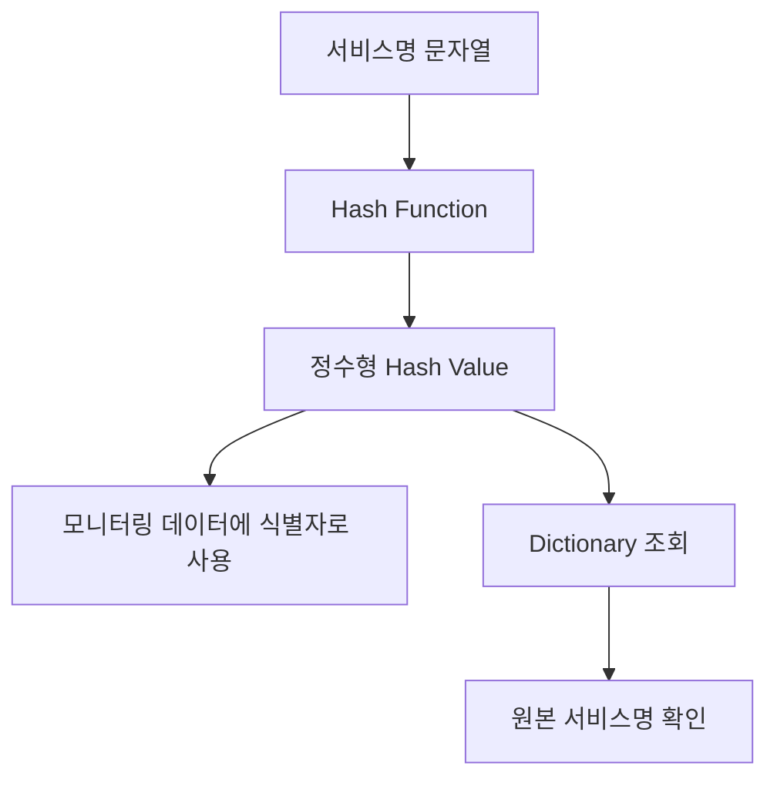
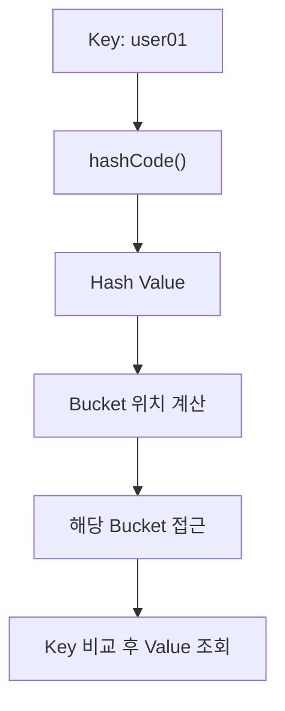

최근 팀 세미나에서 발표를 맡았던 팀원(얼마 전 입사한 신입 개발자)이 Scouter의 데이터 저장 방식에 대해 설명한 적이 있습니다. Scouter는 데이터 크기를 줄이기 위해 서비스명이나 에러 메시지 등의 문자열을 정수형 Hash Value로 변환하여 관리한다는 내용이었습니다.

그 설명을 듣고 Hash Value가 무엇인지 질문했는데, 명확한 답변을 듣지 못했습니다.

Oracle의 다섯 번째 DoS 보안 지침인 **DOS-5: Avoid using user input as hash keys**에 대해 포스팅을 하면서 그때 생각이 났습니다. 우리 팀원에게 Hash와 Hash Value의 개념부터 실제 활용 방법까지 어떻게 설명하면 좋을지 고민하게 되었습니다. 

그리고 그 고민의 결과를 이번 별첨으로 정리했습니다.

---

## 1. Hash란 무엇인가?

Hash는 입력 데이터를 Hash Function을 통해 일정한 규칙에 따라 변환하는 개념입니다. 이때 생성된 결과를 **Hash Value**라고 합니다.

즉, Hash를 이해하기 위해서는 다음 세 가지 용어를 구분하면 됩니다.

- **Hash:** 입력 데이터를 일정한 규칙에 따라 변환하는 개념
- **Hash Function:** 입력 데이터를 처리하여 Hash Value를 생성하는 함수
- **Hash Value:** Hash Function이 생성한 결과값

이를 간단하게 표현하면 다음과 같습니다.



Java에서는 `hashCode()` 메서드를 통해 객체의 Hash Value를 얻을 수 있습니다.

예를 들어 다음과 같습니다.

```java
String value = "hello";

System.out.println(value.hashCode());
```

실행 결과는 다음과 같습니다.

```text
99162322
```

여기서 `hashCode()`는 Hash Function의 역할을 하며, 반환된 `99162322`가 Hash Value입니다.

Java의 `String.hashCode()`는 문자열의 내용을 기준으로 계산하기 때문에 동일한 문자열은 항상 동일한 Hash Value를 반환합니다.

하지만 **서로 다른 데이터가 반드시 서로 다른 Hash Value를 가지는 것은 아닙니다.**

서로 다른 데이터라도 동일한 Hash Value가 생성될 수 있으며 이러한 현상을 Hash Collision이라고 합니다.

---

## 2. 암호학적 Hash와는 무엇이 다를까?

Hash라는 용어는 `HashMap`과 같은 자료구조뿐 아니라 `SHA-1`, `SHA-256`과 같은 암호학적 Hash Function에서도 사용됩니다.

두 방식 모두 입력 데이터를 Hash Function으로 처리하여 Hash Value를 생성한다는 공통점이 있습니다.

하지만 **Hash를 사용하는 목적과 요구되는 특성에는 차이가 있습니다.**

| 구분 | HashMap에서 사용하는 Hash | 암호학적 Hash |
|---|---|---|
| 주요 목적 | 데이터의 효율적인 저장과 조회 | 데이터 무결성 검증 등 보안 목적 |
| Hash Function | Java의 `hashCode()` | `SHA-1`, `SHA-256` 등 |
| Hash Value 크기 | `hashCode()` 기준 32비트 정수 | 알고리즘에 따라 다름 |
| 주요 특성 | 빠른 계산과 데이터의 고른 분포 | 충돌 저항성, 역상 저항성 등 |
| Hash Collision | 발생할 수 있으며 보안 수준의 충돌 저항성을 보장하지 않음 | 의도적으로 충돌을 찾기 어렵도록 설계 |
| 대표적인 사용처 | `HashMap`, `HashSet` | 파일 무결성 검증, 전자서명 등 |

예를 들어 `HashMap`에서는 서로 다른 Key의 Hash Value가 같더라도 `equals()`를 이용하여 실제 Key를 구분할 수 있습니다.

반면 암호학적 Hash Function은 서로 다른 데이터에서 동일한 Hash Value를 의도적으로 찾아내거나, Hash Value로부터 원본 데이터를 알아내기 어렵도록 설계됩니다.

물론 암호학적 Hash에서도 Hash Collision이 발생할 수 있습니다. 다만 안전한 암호학적 Hash Function은 이러한 충돌을 발견하기가 현실적으로 매우 어렵도록 설계된 것입니다.

참고로 SHA-1 역시 암호학적 Hash Function이지만 현재는 충돌 공격에 취약한 것으로 알려져 있어 새로운 보안 시스템에서는 사용을 권장하지 않습니다.

결국 `HashMap`에서 사용하는 Hash는 데이터 처리의 효율성을 중요하게 고려하고, 암호학적 Hash는 충돌 저항성과 같은 보안 특성을 중요하게 고려한다는 차이가 있습니다.

---

## 3. Hash Value는 어디에 사용될까?

Hash Value는 다양한 목적으로 활용할 수 있습니다.

이번에는 앞서 팀 세미나에서 언급되었던 Scouter의 사례와 Java에서 자주 사용하는 `HashMap`, `HashSet`의 사례를 살펴보겠습니다.

### 3.1. 문자열을 짧은 식별자로 표현하는 경우

Scouter는 애플리케이션의 성능 정보를 수집하는 APM(Application Performance Monitoring) 도구입니다.

서비스명이나 에러 메시지와 같은 문자열을 매번 그대로 저장하거나 전송하면 같은 문자열이 반복되는 만큼 데이터 크기가 증가할 수 있습니다.

Scouter는 이러한 문자열을 정수형 Hash Value로 식별하고, 원본 문자열과 Hash Value의 대응 관계를 별도의 Dictionary에서 관리하는 방식을 사용합니다.

예를 들어 다음과 같은 개념입니다.



이렇게 하면 반복적으로 발생하는 모니터링 데이터에 긴 문자열을 매번 포함하는 대신 상대적으로 크기가 작은 정수형 식별자를 사용할 수 있습니다.

여기서 중요한 점은 **Hash Value만으로 원본 문자열을 복원할 수 있는 것은 아니라는 사실**입니다. Hash Function은 암호화와 달리 원본 데이터를 복원하기 위한 역변환 기능을 제공하지 않습니다.

따라서 Scouter는 별도로 관리하는 Dictionary에서 Hash Value에 대응하는 원본 문자열을 조회합니다. 즉, 이 경우에는 **Hash Value를 문자열의 식별자로 활용하여 반복되는 데이터의 저장 및 전송 비용을 줄이는 것**이 주요 목적입니다.

### 3.2. 데이터를 빠르게 검색하는 경우

반면 `HashMap`과 `HashSet`은 Hash Value를 이용해 데이터를 빠르게 저장하고 검색합니다.

예를 들어 10만 개의 회원 ID 중 특정 회원 ID가 존재하는지 확인한다고 가정하겠습니다.

`ArrayList`에 저장했다면 일반적으로 처음부터 데이터를 하나씩 비교해야 합니다. 찾으려는 데이터가 마지막에 있다면 최대 10만 개의 데이터를 확인해야 할 수도 있습니다.

반면 `HashSet`은 회원 ID의 Hash Value를 계산하여 데이터가 저장되어 있을 가능성이 있는 Bucket을 빠르게 찾을 수 있습니다. 이러한 원리로 Hash 기반 자료구조는 일반적인 상황에서 검색뿐 아니라 삽입과 삭제도 효율적으로 처리할 수 있습니다.

`HashMap`과 `HashSet`은 모두 Hash를 사용하지만 목적에는 차이가 있습니다.

- **`HashMap`:** Key와 Value를 함께 저장하며, Key를 이용해 Value를 빠르게 조회합니다.
- **`HashSet`:** 중복을 허용하지 않는 데이터 집합을 관리하며, 특정 데이터의 존재 여부를 빠르게 확인합니다.

참고로 `HashSet` 역시 내부적으로 `HashMap`을 사용하여 데이터를 관리합니다.

그렇다면 Hash Value를 사용하면 왜 빠르게 검색할 수 있을까요?

`HashMap`은 Key의 `hashCode()`를 호출하여 Hash Value를 구하고, 이를 이용해 데이터를 저장할 Bucket의 위치를 결정합니다.

데이터를 검색할 때도 같은 과정을 거칩니다.



여기서 중요한 점은 **Hash Value가 곧 Bucket의 위치를 의미하는 것은 아니라는 것**입니다.

`HashMap`은 Hash Value를 내부적으로 가공하여 실제 Bucket의 위치를 계산합니다.

또한 동일한 Bucket에 여러 Key가 저장되어 있다면 `equals()` 등을 이용하여 원하는 Key를 구분합니다.

이처럼 Hash 기반 자료구조는 Hash Value를 이용하여 검색 범위를 빠르게 좁힐 수 있기 때문에 효율적인 데이터 검색이 가능합니다.

---

## 4. HashSet과 HashMap을 활용한 코드 개선 사례

실무에서도 `HashSet`이나 `HashMap`을 활용하면 간단하게 해결할 수 있는 문제를 반복문으로 비효율적으로 처리하는 경우가 종종 있습니다. 대표적인 두 가지 사례를 살펴보겠습니다.

### 4.1. HashSet을 활용한 중복 데이터 검사

먼저 회원 ID 목록에서 중복된 값이 있는지 확인하는 경우입니다.

**개선 전**

```java
public boolean hasDuplicate(List<String> userIds) {
    for (int i = 0; i < userIds.size(); i++) {
        for (int j = i + 1; j < userIds.size(); j++) {
            if (Objects.equals(userIds.get(i), userIds.get(j))) {
                return true;
            }
        }
    }
    return false;
}
```

위 코드는 이중 반복문을 사용하여 회원 ID를 하나씩 비교합니다. 데이터가 많아질수록 비교 횟수가 크게 증가할 수 있습니다.

하지만 `HashSet`을 사용하면 다음과 같이 개선할 수 있습니다.

**개선 후**

```java
public boolean hasDuplicate(List<String> userIds) {
    Set<String> uniqueIds = new HashSet<>();

    for (String userId : userIds) {
        if (!uniqueIds.add(userId)) {
            return true;
        }
    }
    return false;
}
```

`HashSet`의 `add()` 메서드는 이미 존재하는 값이면 `false`를 반환합니다. 따라서 별도의 이중 반복문 없이 중복 여부를 확인할 수 있습니다.

Hash Value를 이용해 데이터의 존재 여부를 빠르게 확인하므로 일반적인 상황에서는 비교 작업을 크게 줄일 수 있습니다.

### 4.2. HashMap을 활용한 데이터 조회

이번에는 회원 목록에서 회원 ID를 이용하여 회원 정보를 반복적으로 조회하는 경우입니다.

**개선 전**

```java
public User findUser(List<User> users, String userId) {
    for (User user : users) {
        if (Objects.equals(user.getId(), userId)) {
            return user;
        }
    }
    return null;
}
```

위 코드는 회원 정보를 조회할 때마다 목록을 처음부터 순회합니다.

한두 번 조회하는 상황이라면 큰 문제가 없겠지만, 동일한 회원 목록에서 여러 회원을 반복적으로 조회해야 한다면 불필요한 비교 작업이 계속 발생합니다. 이러한 경우 `HashMap`을 활용할 수 있습니다.

**개선 후**

```java
Map<String, User> userMap = new HashMap<>();

for (User user : users) {
    userMap.put(user.getId(), user);
}

// 회원 ID를 이용한 반복 조회
User user1 = userMap.get("user01");
User user2 = userMap.get("user02");
```

처음에는 회원 목록을 순회하며 `HashMap`을 생성해야 하지만, 이후에는 회원 ID를 Key로 사용하여 원하는 회원 정보를 빠르게 조회할 수 있습니다.

다만 회원 ID가 중복된다면 기존 데이터가 덮어써질 수 있으므로 Key의 유일성을 고려해야 합니다.

이처럼 **`HashSet`은 중복 여부 확인에, `HashMap`은 Key를 이용한 반복적인 데이터 조회에 효과적으로 활용할 수 있습니다.**

물론 모든 반복문을 Hash 기반 자료구조로 변경하는 것이 좋은 것은 아닙니다. 데이터의 개수와 조회 횟수, 중복 허용 여부 등을 고려하여 적절한 자료구조를 선택하는 것이 중요합니다.

---

## 5. Hash Collision은 왜 발생할까?

Hash Function을 사용하더라도 서로 다른 입력 데이터가 동일한 Hash Value를 가질 수 있습니다.

```java
System.out.println("Aa".hashCode());
System.out.println("BB".hashCode());
```

실제로 위 코드의 실행 결과는 다음과 같습니다.

```text
2112
2112
```

"Aa"와 "BB"는 서로 다른 문자열이지만 Hash Value는 동일합니다. 이러한 현상을 **Hash Collision**이라고 합니다.

Hash Collision이 발생하는 이유는 입력 가능한 데이터의 종류에 비해 Hash Value로 표현할 수 있는 값의 개수가 제한되어 있기 때문입니다.

Java의 `hashCode()`는 32비트 정수를 반환하므로 모든 문자열에 서로 다른 Hash Value를 부여할 수는 없습니다. 또한 Hash Value가 서로 다르더라도 Bucket의 개수는 제한되어 있기 때문에 같은 Bucket에 저장될 수 있습니다.

Hash Collision 자체는 정상적인 현상이지만, 특정 Bucket에 데이터가 지나치게 집중되면 Key를 비교하는 작업이 많아져 처리 성능이 저하될 수 있습니다.

이러한 특성을 악용하면 앞선 DOS-5 본편에서 살펴본 것처럼 서비스 거부 취약점으로 이어질 수 있습니다.