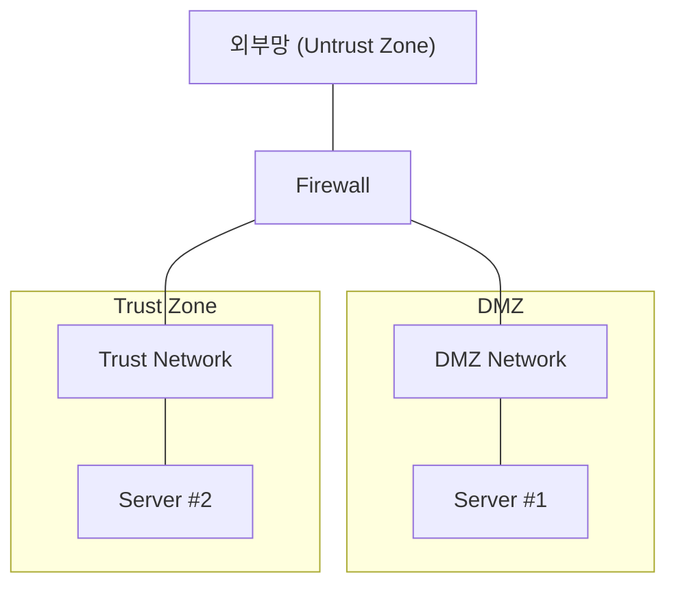
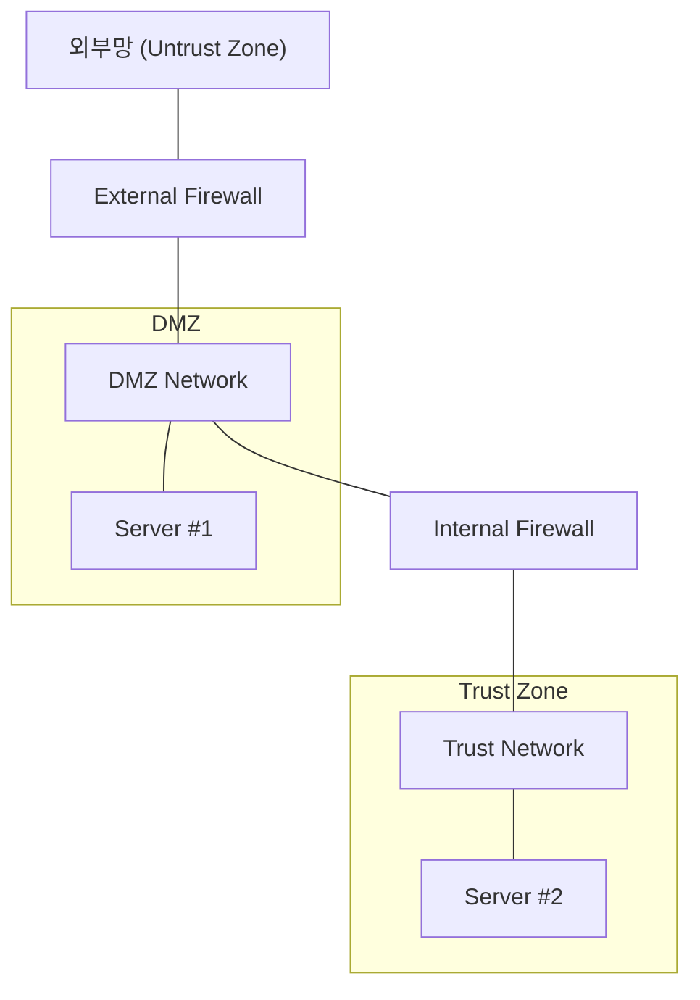

개발팀장으로서 주어진 업무를 차질 없이 수행하도록 관리하는 것도 중요하지만, **앞으로 개발팀이 어떤 일을 해야 할지 스스로 고민하고 기획하면서 기술적인 방향성을 제시하는 것 역시 중요한 역할**이라고 생각합니다.

또한 **기술적 의사결정의 순간에 보다 합리적인 판단을 내리기 위해서는 모든 기술에 대한 깊이 있는 전문 지식까지는 아니더라도 관련 기술의 기본적인 개념과 특징, 장단점을 이해**하고 있어야 합니다.

개발 실무를 수행하지는 않지만, 꾸준히 학습을 이어가는 이유입니다. 물론 쉽지는 않습니다.

그래도 머릿속으로 구상했던 것들이 실제 회사 업무를 통해 하나씩 실현되어 가는 과정에서 느끼는 성취감이 동기 부여가 되는 것 같습니다.

---

## 1. 토이 프로젝트의 목표

개인적으로 수행하는 토이 프로젝트도 실제 서비스 운영 환경과 유사한 네트워크 환경에서 진행한다면 실무 적용 가능성을 보다 현실적으로 검토할 수 있을 것이라 생각했습니다.

개별 기술이나 기능의 검증뿐만 아니라 네트워크 보안 영역에 따른 시스템 배치와 서버 간 통신 방식까지 함께 검토할 수 있기 때문입니다.

그래서 개인 노트북에 **외부망**, **DMZ**, **Trust Zone**이 분리된 네트워크 실습 환경을 구축하고, 향후 수행하게 될 토이 프로젝트에서 공통으로 활용해 보려고 합니다.

이를 위해 `VirtualBox`에서 제공하는 가상 네트워크 기능과 방화벽 솔루션인 `pfSense`를 사용할 예정입니다.

구체적인 목표는 다음과 같습니다.

- **네트워크 보안 아키텍처의 이해**
  - 외부망, DMZ, Trust Zone의 개념과 네트워크 영역을 분리하는 목적
  - 방화벽의 역할과 네트워크 영역 간 접근 제어 원리
  - 단일 방화벽과 이중 방화벽 기반 아키텍처의 특징과 차이점

- **가상 네트워크 실습 환경 구축**
  - VirtualBox의 가상 네트워크 기능을 활용한 네트워크 영역 분리
  - pfSense를 활용한 가상 방화벽 구축
  - 네트워크 영역 간 통신을 위한 라우팅 설정
  - 단일 방화벽과 이중 방화벽 기반의 네트워크 아키텍처 구현

- **네트워크 영역 간 접근 제어 검증**
  - 방화벽 정책에 따른 통신 허용 및 차단 검증
  - 방화벽 로그를 통한 접근 제어 결과 확인
  - 두 아키텍처에서의 접근 제어 방식과 특징 비교

다만 별도의 서비스 애플리케이션을 구현하지 않고, 네트워크 실습 환경을 구축하여 의도한 대로 접근 제어가 이루어지는지 검증하는 것까지만 진행할 예정입니다.

---

## 2. 구현하고자 하는 네트워크 아키텍처

단일 방화벽(Single Firewall)과 이중 방화벽(Dual Firewall) 기반의 네트워크 아키텍처를 각각 구현해 볼 것입니다.

두 아키텍처 모두 외부망, DMZ, Trust Zone을 서로 다른 네트워크 영역으로 분리하고, 방화벽을 통해 영역 간 접근을 제어한다는 공통점이 있습니다. 하지만 방화벽의 배치와 접근 제어 방식에는 차이가 있습니다.

### 2.1. 단일 방화벽 기반의 네트워크 아키텍처

하나의 방화벽에 세 개의 네트워크 인터페이스를 구성하여 **외부망**, **DMZ**, **Trust Zone**을 분리하는 구조입니다. 이러한 구조를 <mark>Three-legged Firewall</mark>이라고도 합니다.

모든 네트워크 영역 간 통신은 하나의 방화벽을 경유하며 출발지와 목적지, 포트 등의 조건을 기반으로 설정된 방화벽 정책에 따라 접근이 허용되거나 차단됩니다.

비교적 단순한 구조이기 때문에 네트워크 영역의 분리와 방화벽을 통한 접근 제어의 기본 원리를 이해하는 데 도움이 될 것 같습니다.

---

### 2.2. 이중 방화벽 기반의 네트워크 아키텍처

외부 방화벽과 내부 방화벽 사이에 **DMZ**를 배치하는 구조입니다.

외부 방화벽은 **외부망**과 **DMZ** 사이의 접근을 제어하고, 내부 방화벽은 **DMZ**와 **Trust Zone** 사이의 접근을 제어합니다.

두 개의 방화벽을 통해 독립적인 보안 정책을 적용할 수 있으며, 외부 방화벽이나 **DMZ** 영역의 서버가 침해되더라도 내부 방화벽을 통해 **Trust Zone**에 대한 접근을 추가적으로 제한할 수 있습니다.

이중 방화벽 구조는 하나의 보안 통제가 무력화되더라도 다른 보안 통제를 통해 위협에 대응할 수 있도록 하는 전략을 네트워크 아키텍처에 적용한 사례라고 할 수 있습니다.

---

## 3. 다음 포스팅

실습 환경을 구축하기에 앞서 네트워크 보안에 대한 기본적인 개념부터 학습해 보려고 합니다.

다음 포스팅에서는 네트워크를 여러 보안 영역으로 분리하는 이유와 **외부망**, **DMZ**, **Trust Zone**의 개념 및 각 영역의 특징을 살펴보겠습니다.

그리고 분리된 네트워크 영역 사이에서 방화벽이 어떤 역할을 하는지 알아보겠습니다.
