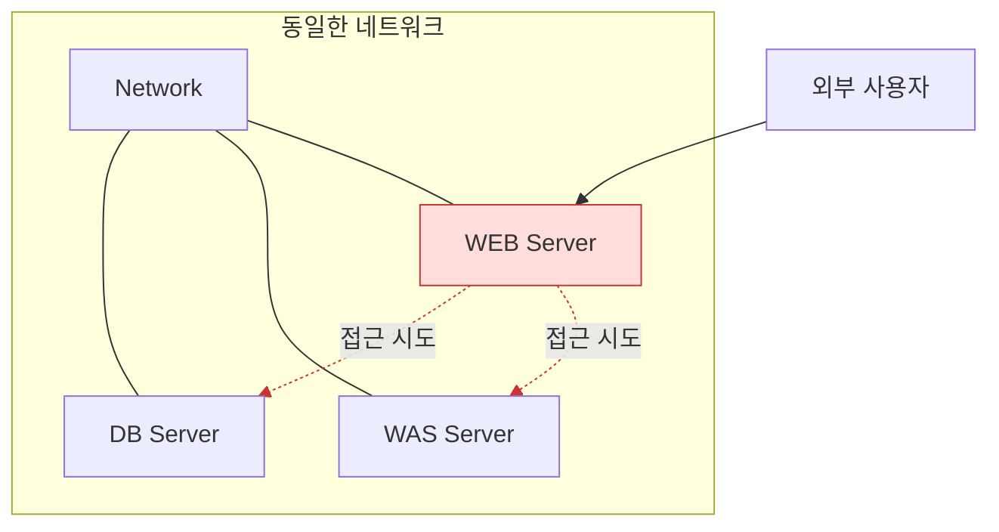
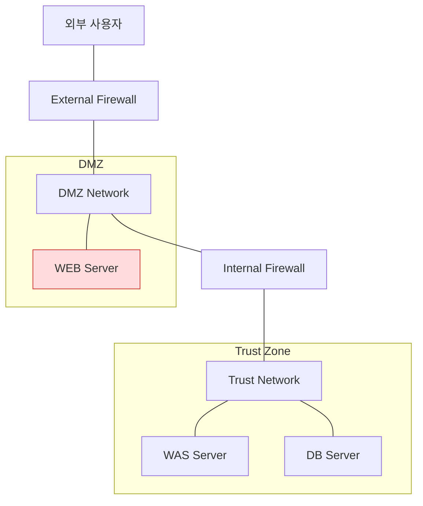
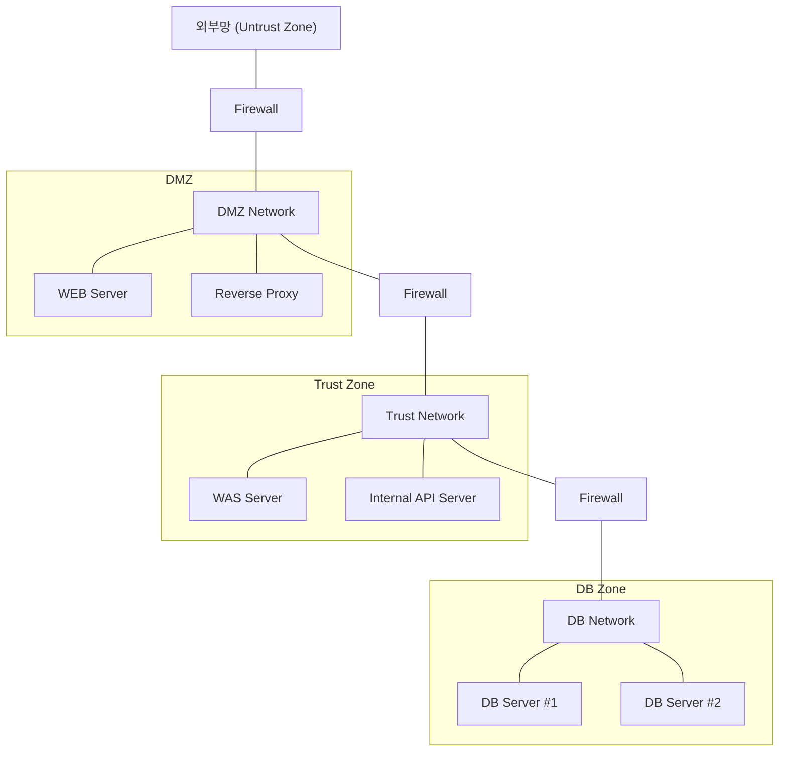
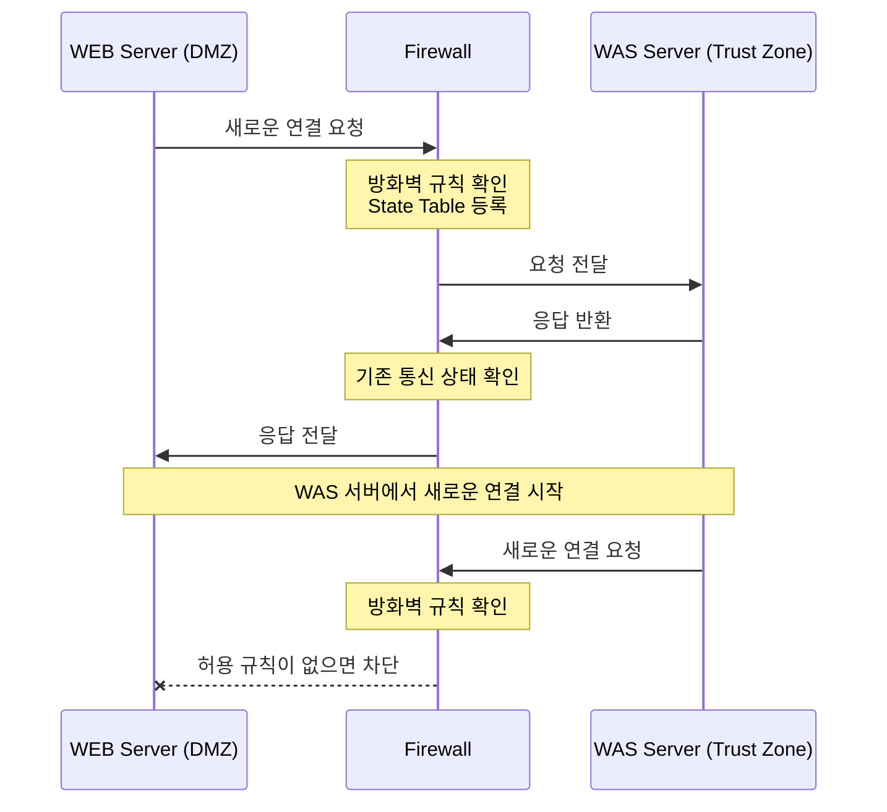

2002년 1월에 첫 회사에 입사했고, 지금 다니고 있는 회사가 네 번째 회사입니다.

현재 근무 중인 회사에 입사하기 전까지는 네트워크를 여러 보안 영역으로 분리하고, 영역 간 접근을 엄격하게 제어하는 환경에서 서비스를 개발하고 운영해 본 경험이 없었습니다.

그래서 개발자로서 적지 않은 경력을 쌓아왔지만, 네트워크 보안에 대해 깊이 있게 고민해 볼 기회는 많지 않았습니다. 네트워크 보안에 대한 이해가 부족하다 보니 시스템이 특정 네트워크 영역에 배치되는 이유나 시스템 간 연동 방식이 그렇게 설계된 이유를 제대로 이해하기 어려웠던 것도 사실입니다.

현재 회사에 다니면서 가장 만족스러운 부분 중 하나는 **체계적인 IT 인프라와 보안 체계를 갖춘 환경에서 서비스를 개발하고 운영하는 경험을 쌓을 수 있다는 점**입니다. 입사 후 지난 2년여간 개인적으로 많은 것을 배울 수 있었습니다.

**네트워크를 여러 보안 영역으로 분리하고 방화벽을 통해 영역 간 접근을 제어하는 것은 네트워크 보안을 강화하기 위한 기본적인 방법 중 하나입니다.**

본격적으로 네트워크 실습 환경을 구축하기에 앞서 이러한 네트워크 영역의 분리가 왜 필요한지, 그리고 분리된 영역 사이에서 방화벽은 어떤 역할을 하는지 살펴보도록 하겠습니다.

---

## 1. 네트워크를 보안 영역으로 분리하는 이유

서비스를 구성하는 WEB 서버, WAS 서버, DB 서버가 모두 하나의 네트워크에 연결되어 있고, 서버 간 접근을 제한하는 별도의 보안 통제가 없다고 가정해 보겠습니다.

외부에 노출된 WEB 서버가 침해되었을 경우, 공격자가 WEB 서버를 통해 WAS 서버나 DB 서버로 접근을 시도할 수 있을 것입니다.

결국 **하나의 서버에서 발생한 보안 사고가 다른 서버로 확산될 가능성이 높아지는 것**입니다.

**네트워크를 분리하지 않는 경우**

이러한 위험을 줄이기 위한 방법 중 하나가 <mark>네트워크 분리(Network Segmentation)</mark>입니다. 네트워크 분리는 하나의 네트워크를 물리적 또는 논리적으로 여러 개의 네트워크 영역으로 나누는 것을 의미합니다.

분리된 네트워크 영역에 서로 다른 접근 제어 정책을 적용함으로써 다음과 같은 보안 효과를 얻을 수 있습니다.

- 외부에 노출할 시스템과 내부에서 보호할 시스템을 구분할 수 있습니다.
- 네트워크 영역 간 불필요한 접근을 제한하여 공격에 노출되는 범위(Attack Surface)를 줄일 수 있습니다.
- 하나의 시스템에서 발생한 보안 사고가 다른 시스템으로 확산되는 위험을 줄일 수 있습니다.
- 네트워크 영역 간 통신을 모니터링하고 관리할 수 있습니다.

여기서 중요한 점은 **단순히 네트워크를 분리하는 것만으로는 충분하지 않으며, 분리된 네트워크 영역 간의 접근을 적절하게 제어해야 한다는 것**입니다.

이를 위해 사용되는 대표적인 보안 수단이 **방화벽(Firewall)**입니다.

**네트워크를 분리하고 접근을 제어하는 경우**

위와 같이 외부에 노출되는 WEB 서버와 내부에서 보호해야 하는 WAS 서버 및 DB 서버를 서로 다른 네트워크 영역에 배치하고, 방화벽을 통해 영역 간 접근을 제어할 수 있습니다.

이렇게 구성하면 WEB 서버가 침해되더라도 방화벽의 접근 제어 정책을 통해 내부 시스템에 대한 불필요한 접근을 차단함으로써 보안 사고의 확산 범위를 제한할 수 있습니다.

물론 이미 허용된 통신 경로를 통한 보안 위협까지 모두 차단할 수 있는 것은 아니므로 시스템 자체에 대한 보안 관리도 함께 이루어져야 합니다.

결국 **네트워크를 분리하는 목적은 시스템의 역할과 보안 요구사항에 따라 서로 다른 접근 제어 정책을 적용할 수 있는 구조를 마련하는 것**이라고 할 수 있습니다.

---

## 2. 네트워크 보안 영역의 구분

그렇다면 **네트워크를 어떤 기준으로 분리해야 할까요?**

시스템의 역할과 외부 노출 여부, 처리하는 데이터의 중요도 등 보안 요구사항을 고려하여 네트워크를 여러 보안 영역(Security Zone)으로 구분할 수 있습니다.

네트워크 보안 영역의 구분 방법이나 명칭이 정해져 있는 것은 아닙니다. 조직의 보안 정책과 서비스의 특성에 따라 다양한 형태로 구성할 수 있습니다.

대표적인 구성 방식 중 하나는 **외부망(Untrust Zone)**, **DMZ(Demilitarized Zone)**, **Trust Zone**의 세 영역으로 구분하는 것입니다.

| 네트워크 영역 | 특징 |
| --- | --- |
| 외부망(Untrust Zone) | 조직이 직접 통제하기 어려우며 신뢰할 수 없는 외부 네트워크 영역 |
| DMZ(Demilitarized Zone) | 외부에 서비스를 제공하면서 내부 네트워크의 직접적인 노출을 방지하기 위한 영역 |
| Trust Zone | 외부에 직접 노출할 필요가 없는 내부 시스템을 배치하고 보호하기 위한 영역 |

### 2.1. 외부망(Untrust Zone)

**외부망**은 **조직의 보안 정책으로 직접 통제하기 어렵고, 해당 영역에서 발생하는 접근을 기본적으로 신뢰할 수 없는 네트워크 영역**입니다. 대표적으로 인터넷이 이에 해당합니다.

**외부망**에서는 서비스를 이용하기 위한 정상적인 접근뿐만 아니라 보안 위협이 될 수 있는 비정상적인 접근도 발생할 수 있습니다.

따라서 **외부망**에서 조직 내부의 네트워크로 접근하는 경우에는 서비스를 제공하기 위해 필요한 통신만 제한적으로 허용해야 합니다.

### 2.2. DMZ(Demilitarized Zone)

**DMZ**는 비무장 지대(Demilitarized Zone)라는 의미로, 네트워크 보안에서는 **외부에 서비스를 제공하면서 내부 네트워크를 보호하기 위해 외부망과 내부망 사이에 구성하는 별도의 네트워크 영역**을 의미합니다.

외부 사용자에게 서비스를 제공하기 위해서는 외부망에서 접근할 수 있는 시스템이 필요합니다. 그렇다고 이러한 시스템을 내부 네트워크에 함께 배치하면 해당 시스템이 침해되었을 때 내부의 다른 시스템까지 보안 위협에 노출될 수 있습니다.

이러한 위험을 줄이기 위해 외부에 서비스를 제공하는 시스템을 내부 네트워크와 분리된 **DMZ**에 배치합니다.

DMZ에 배치할 수 있는 대표적인 시스템은 다음과 같습니다.

* 외부 서비스를 제공하는 WEB 서버
* Reverse Proxy 서버
* 외부 API 요청을 처리하는 API Gateway
* 외부 DNS 서버
* 외부 메일 통신을 처리하는 메일 서버

외부망에서 **DMZ**로의 접근은 서비스를 제공하기 위해 필요한 통신만 허용하고, **DMZ**에서 내부망으로의 접근 역시 서비스 처리에 필요한 통신만 허용하도록 구성합니다.

즉, **DMZ**는 **외부에 서비스를 제공하면서 내부 네트워크가 외부에 직접 노출되지 않도록 보호하는 완충 영역**이라고 할 수 있습니다.

### 2.3. Trust Zone

**Trust Zone**은 **외부로부터의 접근을 제한하여 내부 시스템을 보호하기 위한 네트워크 영역**입니다. 일반적으로 외부에 직접 노출할 필요가 없는 시스템을 배치합니다.

* 비즈니스 로직을 처리하는 WAS 서버
* 내부 API 서버
* DB 서버
* 내부 업무 시스템
* 인증 및 암호화 서비스 서버

외부망에서 **Trust Zone**으로의 직접적인 접근은 원칙적으로 차단하고, **DMZ**에서 **Trust Zone**으로의 접근 역시 업무상 필요한 통신만 허용하도록 구성합니다.

다만 **Trust Zone에 위치한다고 해서 해당 영역의 모든 시스템과 통신을 무조건 신뢰하는 것은 아닙니다.**

내부 시스템의 역할과 중요도에 따라 **Trust Zone**을 여러 보안 영역으로 세분화하고, 추가적인 접근 제어 정책을 적용할 수도 있습니다.

대표적인 예로 DB 서버를 별도의 **DB Zone**에 배치하거나 시스템 관리를 위한 **Management Zone**을 별도로 구성하는 방식이 있습니다.

**DB 서버를 별도의 보안 영역으로 분리한 네트워크 아키텍처 예시**

WAS 서버와 DB 서버가 동일한 네트워크에 위치하면 두 서버 간 통신은 네트워크 영역 사이에 배치된 방화벽을 경유하지 않습니다.

하지만 위와 같이 DB 서버를 별도의 **DB Zone**에 배치하면 **Trust Zone**에 위치한 시스템에서 DB 서버로 접근하는 경우에도 방화벽을 통해 접근을 제어할 수 있습니다. 이를 통해 DB 서버에 접근할 필요가 있는 시스템만 접근할 수 있도록 제한할 수 있습니다.

물론 네트워크 보안 영역을 세분화한다고 해서 반드시 물리적인 방화벽 장비를 추가해야 하는 것은 아닙니다.

다만 **네트워크 보안 영역을 세분화할수록 네트워크 구성과 방화벽 정책의 관리가 복잡해질 수 있으므로 보안성과 운영 효율성을 함께 고려해야 합니다.**

---

## 3. 방화벽(Firewall)의 역할과 동작 원리

네트워크를 여러 영역으로 분리하더라도 서비스를 제공하기 위해서는 서로 다른 네트워크 영역에 위치한 시스템 간 통신이 필요합니다.

이때 필요한 통신은 허용하고 불필요한 통신은 차단하기 위해 사용하는 것이 방화벽입니다.

그렇다면 **방화벽은 어떤 기준으로 통신을 허용하거나 차단하는 것일까요?**

### 3.1. 방화벽 정책(Firewall Policy)

방화벽의 역할은 네트워크를 통해 전달되는 트래픽을 사전에 설정된 보안 정책에 따라 허용하거나 차단하는 것입니다.

일반적인 네트워크 방화벽에서는 패킷의 출발지와 목적지, 프로토콜, 포트 등의 정보를 기반으로 접근 제어 정책을 설정할 수 있습니다.

| 항목 | 설명 |
| --- | --- |
| Source IP | 패킷의 출발지 IP 주소 |
| Destination IP | 패킷의 목적지 IP 주소 |
| Protocol | TCP, UDP, ICMP 등의 통신 프로토콜 |
| Source Port | TCP 또는 UDP 패킷의 출발지 포트 |
| Destination Port | TCP 또는 UDP 패킷의 목적지 포트 |
| Action | 해당 패킷의 허용 또는 차단 여부 |

예를 들어 DMZ에 위치한 WEB 서버에서 Trust Zone에 위치한 WAS 서버로 REST API를 호출해야 한다고 가정해 보겠습니다.

| 구분 | WEB 서버 | WAS 서버 |
| --- | --- | --- |
| 네트워크 보안 영역 | DMZ | Trust Zone |
| IP 주소 | 192.168.10.10 | 192.168.20.10 |
| 서비스 포트 | 443 | 8080 |

WEB 서버에서 WAS 서버의 REST API를 호출할 수 있도록 다음과 같은 방화벽 정책을 설정할 수 있습니다.

| Source IP | Destination IP | Protocol | Source Port | Destination Port | Action |
| --- | --- | --- | --- | --- | --- |
| 192.168.10.10 | 192.168.20.10 | TCP | Any | 8080 | Allow |

위와 같이 방화벽 정책을 설정하면 WEB 서버에서 WAS 서버의 TCP 8080 포트로 접근하는 것을 허용할 수 있습니다.

참고로 WEB 서버에서 외부 사용자에게 서비스를 제공하는 포트는 443이지만, WEB 서버가 WAS 서버의 REST API를 호출할 때 사용하는 출발지 포트는 일반적으로 운영체제에 의해 동적으로 할당됩니다.

이러한 포트를 <mark>임시 포트(Ephemeral Port)</mark>라고 합니다.

따라서 위 방화벽 정책에서는 Source Port를 특정 포트로 제한하지 않고 `Any`로 설정했습니다.

즉, **방화벽 정책을 통해 특정 시스템에서 다른 시스템의 지정된 서비스 포트로 접근하는 통신만 허용하도록 구성할 수 있는 것**입니다.

### 3.2. 방화벽 정책의 적용 순서

방화벽에는 여러 개의 접근 제어 규칙(Firewall Rule)을 설정할 수 있습니다.

이때 중요한 것은 각각의 규칙을 어떻게 정의하는지뿐만 아니라 어떤 순서로 적용하는지도 고려해야 한다는 점입니다.

예를 들어 다음과 같은 방화벽 규칙이 설정되어 있다고 가정해 보겠습니다.

| 순서 | Source IP | Destination IP | Protocol | Destination Port | Action |
| --- | --- | --- | --- | --- | --- |
| 1 | 192.168.10.10 | 192.168.20.10 | TCP | 8080 | Allow |
| 2 | 192.168.10.0/24 | 192.168.20.0/24 | Any | Any | Deny |

규칙을 위에서부터 순차적으로 검사하고 처음 일치하는 규칙을 적용하는 방식이라면, WEB 서버에서 WAS 서버의 TCP 8080 포트로 접근하는 것은 첫 번째 규칙에 의해 허용됩니다.

하지만 두 규칙의 순서를 변경하면 DMZ에서 Trust Zone으로의 통신을 차단하는 규칙이 먼저 적용되므로, WEB 서버에서 WAS 서버로의 접근을 허용하는 규칙까지 검사하지 않고 통신을 차단하게 됩니다.

이처럼 처음 일치하는 규칙을 적용하는 방식을 <mark>First Match</mark> 방식이라고 합니다.

이번 토이 프로젝트에서 사용할 `pfSense`의 일반적인 인터페이스 방화벽 규칙도 이러한 방식으로 동작합니다.

따라서 **방화벽 정책을 설정할 때는 개별 규칙의 내용뿐만 아니라 규칙의 적용 순서도 중요**합니다.

### 3.3. 기본 차단 정책(Default Deny)

방화벽을 통해 접근을 제어하는 정책은 크게 두 가지 방식으로 구분할 수 있습니다.

| 구분 | 설명 |
| --- | --- |
| Default Allow | 기본적으로 모든 통신을 허용하고 차단할 통신을 명시적으로 정의하는 방식 |
| Default Deny | 기본적으로 모든 통신을 차단하고 허용할 통신을 명시적으로 정의하는 방식 |

보안 관점에서는 <mark>Default Deny</mark> 방식이 권장됩니다. 발생할 수 있는 모든 보안 위협을 사전에 파악하여 차단 정책을 설정하는 것은 현실적으로 어렵기 때문입니다.

따라서 기본적으로 모든 새로운 통신을 차단하고, 서비스를 제공하거나 시스템을 운영하기 위해 필요한 통신만 명시적으로 허용하는 것입니다.

이는 보안에 있어서 필요한 최소한의 권한만 부여한다는 최소 권한 원칙(Principle of Least Privilege)과도 같은 맥락에서 이해할 수 있습니다.

### 3.4. 상태 기반 접근 제어(Stateful Filtering)

방화벽을 통해 접근을 제어하는 방식을 이해하기 위해 알아두어야 할 또 하나의 개념이 상태 기반 접근 제어(Stateful Filtering)입니다.

앞서 설명한 것처럼 **DMZ**에 위치한 WEB 서버가 **Trust Zone**에 위치한 WAS 서버의 REST API를 호출한다고 가정해 보겠습니다.

WEB 서버에서 WAS 서버로 새로운 TCP 연결을 시작할 수 있도록 방화벽 정책을 설정하면 TCP 연결을 수립하고 HTTP 요청을 전달할 수 있습니다.

그렇다면 WAS 서버가 WEB 서버로 응답을 반환할 수 있도록 역방향의 방화벽 정책도 별도로 설정해야 할까요?

방화벽은 통신의 상태를 관리하는지에 따라 다음과 같이 구분할 수 있습니다.

| 구분 | 설명 |
| --- | ---- |
| Stateless Firewall | 이전 패킷이나 연결 상태를 고려하지 않고 개별 패킷의 정보를 기반으로 접근을 제어 |
| Stateful Firewall | 통신의 상태를 관리하고 기존에 허용된 통신과의 연관성을 고려하여 접근을 제어 |

상태 기반 방화벽(Stateful Firewall)은 허용된 통신의 상태 정보를 상태 테이블(State Table)에 저장하고 관리합니다.

이후 전달되는 패킷이 기존에 허용된 통신에 속하는지를 확인하여 정상적인 응답 패킷이라면 별도의 역방향 허용 규칙 없이도 통과시킬 수 있습니다.

여기서 다음 두 가지 상황은 구분해서 이해해야 합니다.

* WEB 서버의 API 호출에 대해 WAS 서버가 응답을 반환하는 경우
* WAS 서버가 WEB 서버의 API를 호출하기 위해 새로운 연결을 시작하는 경우

첫 번째는 기존에 허용된 연결에 대한 응답이지만, 두 번째는 새로운 연결 요청이므로 별도의 접근 제어 정책이 적용됩니다.

이번 토이 프로젝트에서 사용할 `pfSense` 역시 기본적으로 상태 기반 접근 제어(Stateful Filtering)를 수행합니다.

따라서 **방화벽 정책을 설정할 때는 단순히 어떤 시스템들이 데이터를 주고받는지만이 아니라, 어느 시스템에서 새로운 연결을 시작하는지를 고려**해야 합니다.

---

## 4. 다음 포스팅

지금까지 학습한 내용을 기반으로 네트워크 실습 환경을 설계해 보려고 합니다.

다음 포스팅에서는 `VirtualBox`에서 제공하는 가상 네트워크 기능을 살펴보고, 단일 방화벽과 이중 방화벽 기반의 네트워크 아키텍처를 구현하기 위해 가상 머신을 어떻게 구성하고 연결할 것인지 구체적으로 알아보겠습니다.

