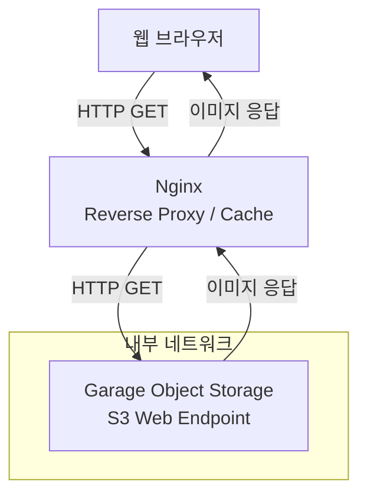

회사에서 새로운 이미지 배포 서버의 구축을 검토하면서 안전한 파일 업로드 기능을 어떻게 구현할 것인지 고민하게 되었습니다.



이어서 업로드된 이미지를 어디에 저장하고, 분산된 웹 서버에 공유할 것인지도 결정해야 했습니다. 솔직히 방법을 몰랐습니다.

이어서 여러 웹 서버에서 동일한 이미지를 제공하기 위한 방법도 결정해야 했습니다. 현재는 `NAS`(Network Attached Storage)에 이미지 파일을 저장하고, 여러 웹 서버가 이를 공유하는 방식으로 운영하고 있습니다.

하지만 새로운 이미지 배포 서버에서는 파일 시스템에 대한 의존성을 줄이고, HTTP API를 통해 이미지 저장소에 접근하는 방식으로 변경하고 싶었습니다.

직접 이미지 경로를 CDN에 연동이 가능하기 때문에 그래서 `Object Storage`를 대안으로 생각하게 되었습니다.

다만 실제 도입 가능성을 판단하기에 앞서 개인적으로 `Object Storage`의 동작 방식을 이해하고 활용 가능성을 검증할 필요가 있었습니다.

이를 위해 `Garage Object Storage`와 `Nginx`를 활용한 간단한 이미지 배포 서버를 구축하는 토이프로젝트를 시작하게 되었습니다.

---

## 1. 왜 Object Storage인가?

현재 사용하고 있는 `NAS`는 파일 시스템을 통해 이미지에 접근하는 방식입니다. 따라서 

반면 `Object Storage`는 데이터를 객체(Object) 단위로 관리하며, 파일 시스템을 직접 마운트하지 않고 `HTTP API`를 통해 접근할 수 있습니다.

| 구분 | NAS | Object Storage |
|---|---|---|
| 데이터 접근 | 파일 시스템 | HTTP API |
| 데이터 관리 | 파일 및 디렉터리 | Bucket 및 Object |
| 다중 서버 접근 | 공유 마운트 | 공통 API Endpoint |
| 애플리케이션 의존성 | 파일 경로 및 마운트 환경 | API Endpoint 및 Object Key |
| 확장 방식 | 스토리지 장비 확장 | 솔루션에 따라 노드 확장 가능 |

현재와 같이 여러 서버에서 동일한 이미지를 사용하려면 `NAS`를 공유 저장소로 마운트하여 접근할 수 있도록 구성해야 합니다.

여러 웹 서버가 `NAS`를 공유하는 구조에서는 각 서버에 파일 시스템을 마운트해야 하며, 마운트 상태나 파일 경로, 접근 권한 등을 관리해야 합니다. 웹 서버가 늘어나거나 운영 환경이 변경될 때도 이러한 설정을 고려해야 합니다.

반면 `Object Storage`는 `HTTP API`를 통해 데이터에 접근하므로 웹 서버마다 저장소를 마운트할 필요가 없습니다. 또한 저장소의 내부 파일 시스템 구조와 관계없이 동일한 API를 통해 이미지에 접근할 수 있습니다.

따라서 이번에는 **웹 서버와 저장소 간의 파일 시스템 의존성을 줄이고, 저장소를 독립적으로 운영할 수 있는 구조**를 만들기 위해 `Object Storage`를 검토하게 되었습니다.

---

## 2. Garage Object Storage

[Garage](https://garagehq.deuxfleurs.fr/)는 자체 서버에 구축할 수 있는 오픈소스 분산 Object Storage입니다.

Amazon S3와 호환되는 API를 제공하기 때문에 S3를 지원하는 다양한 도구와 라이브러리를 활용할 수 있습니다.

Garage를 검토하게 된 이유는 다음과 같습니다.

- 외부 클라우드 서비스 없이 폐쇄망에 구축 가능
- Amazon S3 호환 API 제공
- 여러 스토리지 노드에 데이터를 분산 저장하고 복제하는 기능 지원
- Docker를 활용한 비교적 간단한 실습 환경 구성

다만 Amazon S3의 모든 기능을 지원하는 것은 아니므로 실제 필요한 기능에 대한 호환성 검증은 필요합니다.

웹 서버 3개 VM

이번 프로젝트에서는 복잡한 분산 저장 기능보다는 단일 노드 환경에서 이미지 저장과 배포가 어떻게 이루어지는지 먼저 알아보려고 합니다.

---

## 2. 이미지 배포 서버의 구성

이번 프로젝트의 목표는 **Garage를 외부에 직접 노출하지 않고 Nginx를 통해서만 이미지에 접근할 수 있도록 구성하는 것**입니다.

구상하고 있는 아키텍처는 다음과 같습니다.



각 구성 요소의 역할은 다음과 같습니다.

**Garage Object Storage**

이미지 파일을 객체 형태로 저장합니다.

Garage는 일반적인 S3 API 외에도 정적 파일을 HTTP로 제공하는 Web Endpoint 기능을 지원합니다.

이를 활용하면 별도의 이미지 조회 애플리케이션을 개발하지 않고도 저장된 이미지를 제공할 수 있습니다.

**Nginx**

외부에서 전달되는 이미지 조회 요청을 받아 Garage의 Web Endpoint로 전달합니다.

Reverse Proxy 역할뿐 아니라 캐싱 기능을 활용하여 Garage로 전달되는 요청을 줄이는 방법도 검토할 예정입니다.

**웹 브라우저**

사용자는 Garage의 주소를 알 필요 없이 Nginx에서 제공하는 URL로 이미지를 조회합니다.

예를 들어 다음과 같은 형태입니다.

```text
http://image.example.com/banner.png
```

실제 운영 환경에서는 HTTPS 적용이 필요하지만, 토이프로젝트에서는 우선 HTTP 기반으로 동작을 확인할 계획입니다.

---

## 3. 구현 및 검증 계획

이번 프로젝트에서는 Docker를 사용하여 Nginx와 Garage를 실행할 예정입니다.

이미지 업로드 API는 별도로 개발하지 않고 AWS CLI 등 S3 호환 도구를 사용하여 이미지를 저장할 계획입니다.

구체적인 구현 및 검증 항목은 다음과 같습니다.

### 3.1. Garage 환경 구축

먼저 Docker를 이용하여 Garage 단일 노드를 구성합니다.

Garage의 기본 설정 방법과 데이터 저장 구조를 살펴보고, 이미지 저장을 위한 Bucket을 생성할 예정입니다.

이 과정에서 다음 개념을 알아보려고 합니다.

- Bucket과 Object의 개념
- Object Key를 이용한 데이터 관리
- S3 API Endpoint
- Access Key와 Secret Key
- Web Endpoint와 정적 파일 제공 방식

### 3.2. Nginx Reverse Proxy 구성

Garage에 저장된 이미지를 Nginx를 통해 조회할 수 있도록 구성합니다.

외부에서는 Nginx에만 접근할 수 있도록 하고, Garage의 S3 API와 Web Endpoint는 내부 네트워크에서만 접근하도록 제한할 계획입니다.

단순히 이미지를 조회하는 것뿐 아니라 Nginx에서 요청을 Garage로 전달하는 과정도 확인하려고 합니다.

### 3.3. Nginx 캐싱 검증

이미지는 일반적인 API 응답과 달리 동일한 파일이 반복적으로 조회되는 경우가 많습니다.

따라서 매번 Garage에서 이미지를 읽는 것보다 Nginx에서 캐싱하는 것이 유리할 수 있습니다.

Nginx의 `proxy_cache` 기능을 적용하여 캐싱 전후의 동작을 비교해 볼 계획입니다.

특히 다음 사항을 확인하려고 합니다.

- 최초 이미지 조회 시 Garage 접근 여부
- 동일 이미지 재조회 시 캐시 활용 여부
- 캐시 적용 전후 응답시간 차이
- 이미지 변경 시 기존 캐시 처리 방법

### 3.4. Garage 장애 상황 검증

마지막으로 Garage 컨테이너를 중지한 상태에서 이미지 조회가 어떻게 동작하는지 살펴보려고 합니다.

Nginx에 이미지가 캐싱되어 있다면 Garage에 문제가 발생하더라도 일부 요청은 정상적으로 처리할 수 있을 것입니다.

다만 캐시되지 않은 이미지는 조회할 수 없으며, 캐시된 이미지도 설정에 따라 장애 발생 시 제공되지 않을 수 있습니다.

이러한 차이를 직접 확인하여 이미지 배포 서버의 가용성을 높이기 위해 어떤 설정이 필요한지 알아보려고 합니다.

---

## 4. 다음 포스팅

이번 토이프로젝트는 이미지 배포 서버를 완성하는 것보다 **Garage Object Storage의 동작 방식과 Nginx를 활용한 이미지 배포 구조를 이해하는 것**이 목적입니다.

우선 단일 노드 환경에서 기본 기능을 구현하고, 이후 필요하다면 Garage 클러스터 구성이나 다중 Nginx 환경으로 확장해 볼 생각입니다.

실제 운영 환경에서는 저장소 이중화, 장애 복구, 보안, 성능 등 추가로 검토해야 할 사항이 많습니다.

하지만 이러한 부분을 모두 한 번에 구현하기보다는 작은 환경에서 기본적인 동작 원리를 확인하는 것부터 시작하려고 합니다.

이번 프로젝트를 통해 NAS를 대체할 수 있는 이미지 저장 및 배포 구조에 대한 이해를 높이고, 실제 시스템에 적용할 수 있을지 판단할 기술적 근거를 확보하는 것이 목표입니다.

**참고 자료**

- [Garage 공식 홈페이지](https://garagehq.deuxfleurs.fr/)
- [Garage 공식 문서](https://garagehq.deuxfleurs.fr/documentation/)
- [Garage Quick Start](https://garagehq.deuxfleurs.fr/documentation/quick-start/)
- [Nginx Proxy Module](https://nginx.org/en/docs/http/ngx_http_proxy_module.html)